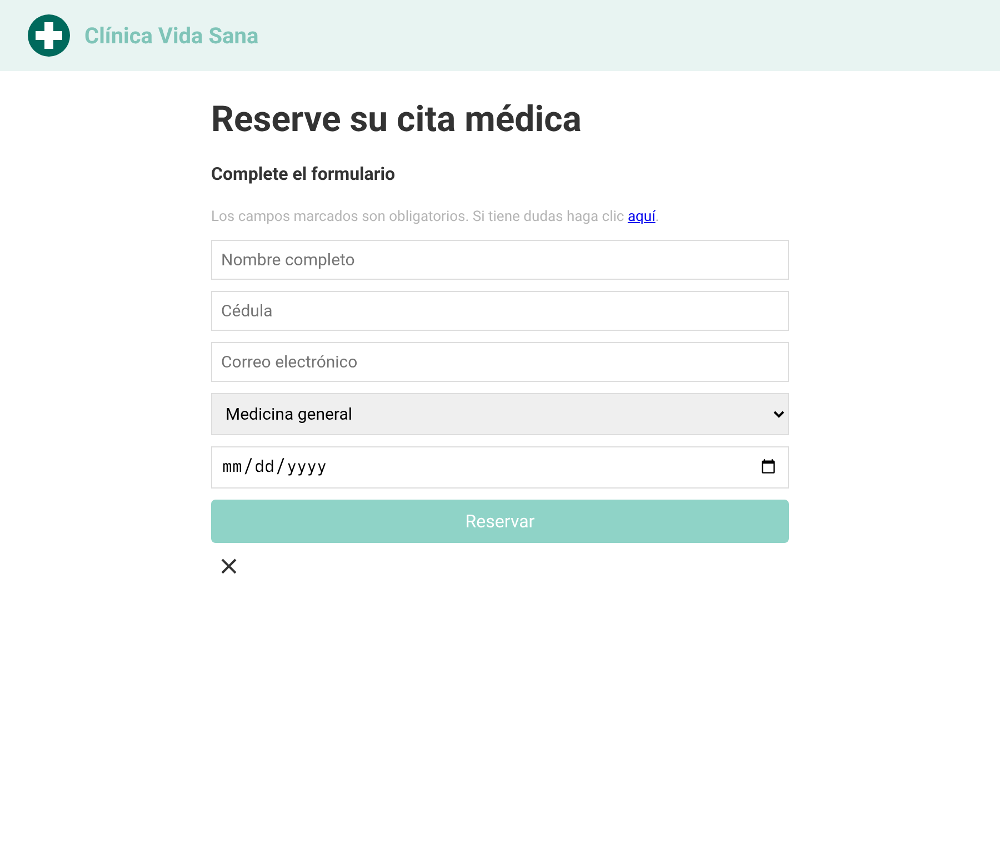
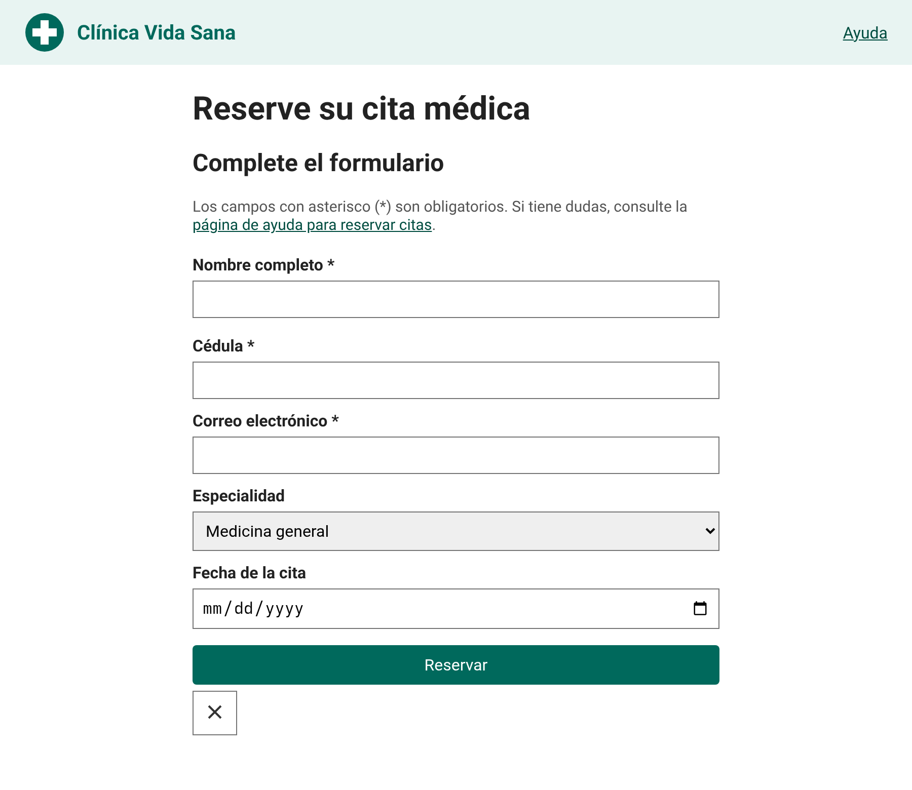
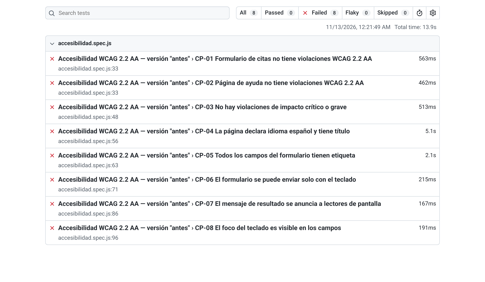
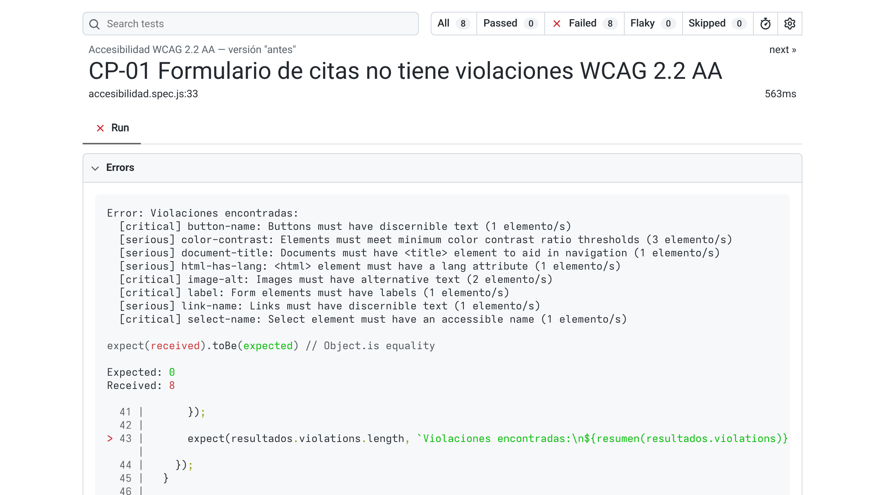

# Taller práctico: Pruebas automatizadas de accesibilidad

Sitio de ejemplo: **Clínica Vida Sana**, un formulario para reservar citas médicas.
El sitio viene en dos versiones:

- `sitio/antes/` — versión con errores de accesibilidad comunes (los mismos que reporta el estudio WebAIM Million).
- `sitio/despues/` — la misma página corregida para cumplir WCAG 2.2 nivel AA.

Las pruebas usan **Playwright** (controla el navegador) y **axe-core** (motor de reglas WCAG de Deque).

## Cómo se ve

El mismo formulario, antes y después de corregir los errores de accesibilidad:

| Antes (`sitio/antes/`) | Después (`sitio/despues/`) |
|---|---|
|  |  |

El reporte HTML de Playwright para cada versión (`npm run reporte:antes` y `npm run reporte:despues`):

| Antes: fallan las 8 pruebas | Después: pasan las 8 pruebas |
|---|---|
|  |  |

Al abrir una prueba fallida, el reporte lista cada violación que encontró axe, con su nivel de impacto:



## Qué cambia entre las dos versiones y por qué

Cada fila es un error sembrado en `sitio/antes/`, su corrección en `sitio/despues/`, a quién afecta y qué prueba lo detecta. La última columna muestra el punto central del taller: axe encuentra los errores de reglas, las pruebas propias (CP-05 a CP-08) encuentran los de comportamiento, y algunos solo aparecen en una revisión manual.

| Error en "antes" | Corrección en "después" | Por qué importa | Criterio WCAG | Quién lo detecta |
|---|---|---|---|---|
| La página no declara idioma | `<html lang="es">` | El lector de pantalla necesita el idioma para pronunciar bien el texto | 3.1.1 | axe y CP-04 |
| La página no tiene título | Un `<title>` que nombra la página y el sitio | El título es lo primero que se anuncia y lo que identifica la pestaña | 2.4.2 | axe y CP-04 |
| Logo sin texto alternativo | `alt="Clínica Vida Sana"` | Sin texto alternativo, la imagen no existe para quien no la ve | 1.1.1 | axe |
| Enlace vacío en el encabezado | Enlace "Ayuda" dentro de un `<nav>` | Un enlace sin texto se anuncia como "enlace", sin decir adónde lleva | 2.4.4, 4.1.2 | axe |
| Texto de bajo contraste (marca, ayuda y botón) | Colores con contraste de al menos 4.5:1 | Con baja visión, o con la pantalla bajo el sol, el texto claro no se lee | 1.4.3 | axe |
| Campos solo con *placeholder* | `<label for>` visible sobre cada campo | El *placeholder* desaparece al escribir; la etiqueta permanece y además se puede pulsar | 1.3.1, 3.3.2 | CP-05 (axe solo marca el campo de fecha) |
| Lista de especialidades sin nombre | `<label for="especialidad">` | El lector de pantalla anuncia una lista sin decir para qué es | 1.3.1, 4.1.2 | axe |
| Botón "Reservar" hecho con `<div onclick>` | `<button type="submit">` | Un `<div>` no recibe el foco ni responde al teclado: sin ratón no se puede enviar el formulario | 2.1.1 | CP-06 |
| Botón de ícono sin nombre | `aria-label="Limpiar formulario"` y `alt=""` en el ícono | El lector de pantalla solo dice "botón", sin indicar qué hace | 4.1.2 | axe |
| `outline: none` al enfocar | Contorno de 3 px en campos, botones y enlaces | Quien navega con teclado no sabe en qué elemento está | 2.4.7 | CP-08 |
| Mensaje de resultado sin `aria-live` | `role="status"` y `aria-live="polite"` | El resultado aparece en pantalla, pero el lector de pantalla no lo anuncia | 4.1.3 | CP-07 |
| Error indicado solo con color rojo | Texto "Error: ...", `aria-invalid`, `aria-describedby` y foco en el campo | Quien no distingue el rojo, o no ve la pantalla, no se entera del error | 1.4.1, 3.3.1 | Revisión manual |
| Salto de encabezado de `<h1>` a `<h4>` | `<h2>` | Quien navega por encabezados pierde la estructura de la página | Buena práctica (1.3.1) | Revisión manual |
| Enlace que dice "aquí" | "página de ayuda para reservar citas" | En una lista de enlaces, "aquí" no dice adónde lleva | Buena práctica (2.4.4) | Revisión manual |

Además de corregir esos errores, la versión corregida agrega regiones (`header`, `nav`, `main`), un enlace para saltar al contenido y `autocomplete` en nombre y correo.

## Requisitos

- Node.js 20 o superior (https://nodejs.org)
- Visual Studio Code (recomendado)
- Conexión a internet para instalar paquetes

## Instalación

```bash
npm install
npx playwright install chromium
```

> Si `npx playwright install` falla por la red, se puede usar el Chrome que ya tenga instalado:
> `CHROME_PATH="/ruta/a/chrome" npm run test:antes`. En Windows, con CMD: `set CHROME_PATH=C:\Program Files\Google\Chrome\Application\chrome.exe`;
> con PowerShell (la terminal por defecto de VS Code): `$env:CHROME_PATH = 'C:\Program Files\Google\Chrome\Application\chrome.exe'`.

## Ejecutar las pruebas

```bash
npm run test:antes      # prueba la versión con errores (se espera que fallen las 8 pruebas)
npm run test:despues    # prueba la versión corregida (se espera que pasen las 8 pruebas)
```

Para ver el reporte HTML:

```bash
npm run reporte:antes
npm run reporte:despues
```

El detalle de cada violación encontrada por axe queda en la carpeta `resultados/` en formato JSON.

## Casos de prueba

| Código | Qué valida | Criterio WCAG |
|---|---|---|
| CP-01 | Escaneo axe completo del formulario | Varios (A y AA) |
| CP-02 | Escaneo axe completo de la página de ayuda | Varios (A y AA) |
| CP-03 | Ninguna violación crítica o grave | Umbral del pipeline |
| CP-04 | Idioma y título de la página | 3.1.1, 2.4.2 |
| CP-05 | Todos los campos tienen etiqueta | 1.3.1, 3.3.2 |
| CP-06 | El formulario se envía solo con teclado | 2.1.1 |
| CP-07 | El mensaje de resultado se anuncia | 4.1.3 |
| CP-08 | El foco del teclado es visible | 2.4.7 |

## Integración continua

El archivo `.github/workflows/accesibilidad.yml` corre las pruebas en GitHub Actions en cada cambio.
Si aparece una violación, el pipeline falla.
