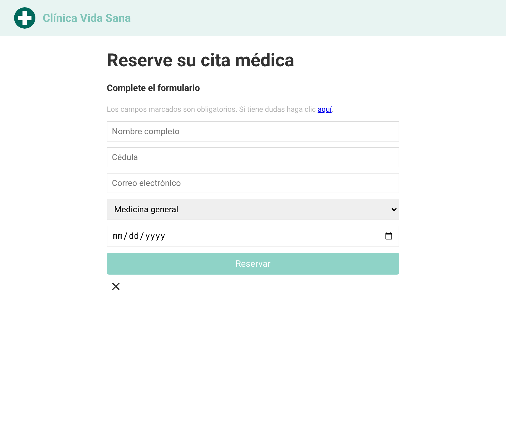
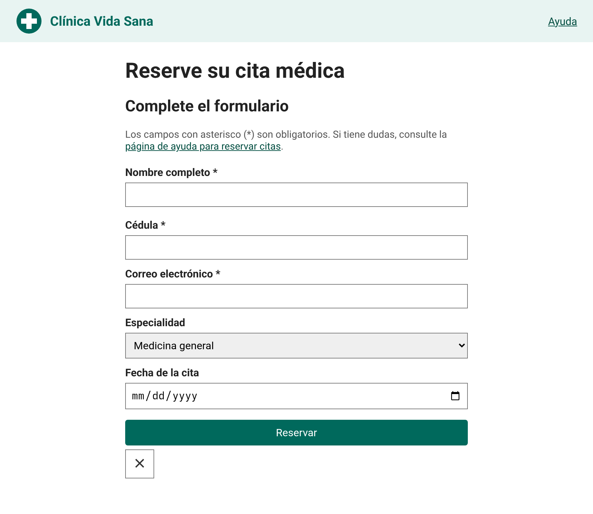
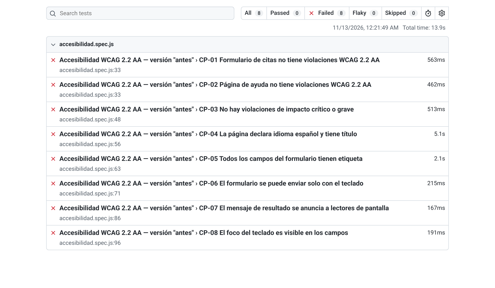
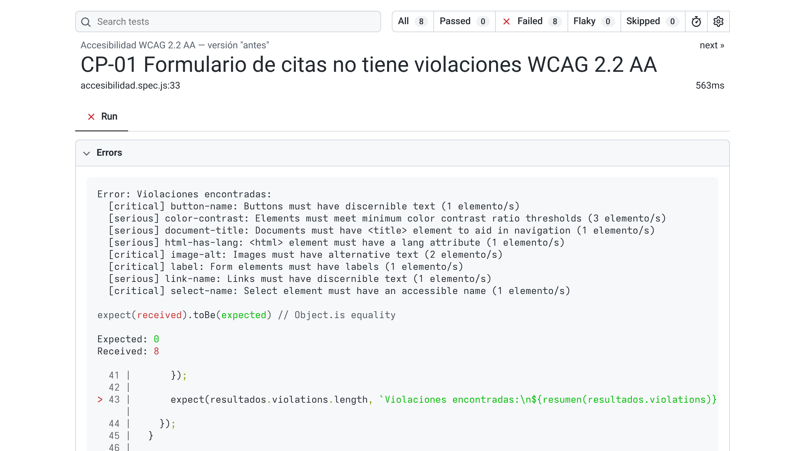
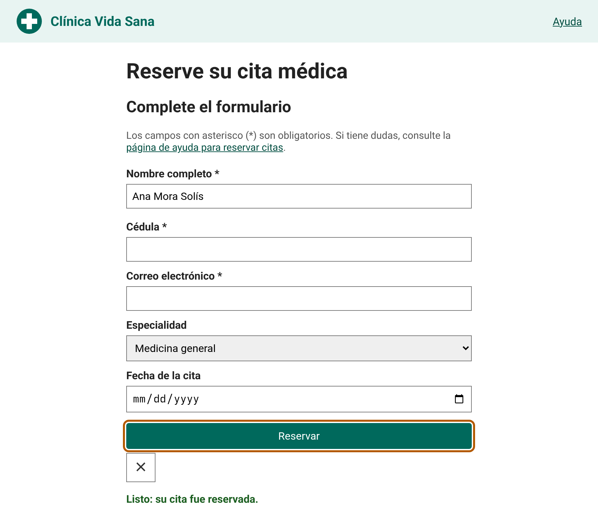

# Gestión de Pruebas Automáticas: Pruebas de Accesibilidad en el Desarrollo e Implementación de Software

## 1. Introducción

Cuando se habla de calidad del software, lo primero que suele venir a la mente es que el sistema haga lo que tiene que hacer, que no se caiga y que responda rápido. Mucho menos se piensa en si una persona ciega, una persona que no puede usar el ratón o un adulto mayor con baja visión puede reservar una cita, pagar un recibo o matricular un curso en ese mismo sistema. Sin embargo, esa pregunta también es una pregunta de calidad. Si un formulario no se puede completar con el teclado, el producto tiene un defecto, aunque funcione perfectamente para quien lo programó.

Este trabajo estudia las **pruebas de accesibilidad automatizadas** como instrumento de calidad en dos fases concretas del ciclo de vida: el **desarrollo**, cuando el equipo escribe y prueba el código, y la **implementación**, cuando ese código se integra, se despliega y se pone en manos de las personas usuarias. La idea central es sencilla: si la accesibilidad se revisa solo al final, con una auditoría puntual, los errores se acumulan y su corrección sale cara. Si se revisa en cada cambio, de forma automática, muchos errores se detectan en el mismo momento en que se cometen.

El tema tiene hoy una urgencia particular. Los estudios anuales sobre el millón de sitios más visitados muestran que casi todas las páginas de inicio tienen errores detectables por máquina (WebAIM, 2026). A la vez, la presión legal creció en Europa, en Estados Unidos y en Costa Rica, donde los lineamientos de 2024 para el sector público piden revisar la accesibilidad en cada despliegue o actualización (MICITT, 2024). Revisar "en cada despliegue" es, en la práctica, una invitación a automatizar.

Pero automatizar no resuelve todo. Las herramientas detectan solo una parte de los problemas, y la cifra exacta depende de cómo se mida. Por eso el trabajo no se limita a describir herramientas: también discute qué puede y qué no puede encontrar una prueba automática, y cómo combinarla con revisiones manuales y con personas usuarias.

El documento se organiza así. La sección 2 plantea el problema en la industria y en la academia y cierra con la pregunta de investigación y los objetivos. La sección 3 explica la metodología, incluido el uso de inteligencia artificial (IA) para construir la base del marco teórico y las estrategias que se usaron para verificar y mejorar lo que la IA produjo. La sección 4 desarrolla el marco teórico: calidad, pruebas, normas, ubicación de las pruebas de accesibilidad en el ciclo de vida, tipos de prueba, métricas y herramientas disponibles. La sección 5 presenta un taller práctico ya construido y ejecutado, con sus resultados reales y un plan de pruebas para aplicarlo con los compañeros del curso. La sección 6 recoge las conclusiones y los aprendizajes.

## 2. Problema

### 2.1 La web sigue siendo inaccesible, y empeora

El estudio WebAIM Million analiza cada año las páginas de inicio del millón de sitios más visitados. Según el informe de 2026, en febrero de 2026 el **95.9 % de esas páginas tenía fallas WCAG 2 A/AA detectables de forma automática**, con un promedio de **56.1 errores por página**, frente a 51 el año anterior (WebAIM, 2026). Otros resúmenes del mismo informe llegan a la misma lectura: la accesibilidad web está retrocediendo (Priority Pixels, 2026).

Lo más llamativo no es el porcentaje, sino el tipo de errores. Según el mismo informe, seis tipos de error concentran el 96 % de todo lo detectado y se repiten desde hace siete años: texto con bajo contraste (83.9 % de las páginas), imágenes sin texto alternativo (53.1 %), campos de formulario sin etiqueta (51 %), enlaces vacíos, botones vacíos y falta del idioma del documento (WebAIM, 2026). Todos estos errores se pueden detectar con herramientas gratuitas que existen desde hace años. Es decir, buena parte de la inaccesibilidad actual no es un problema de conocimiento técnico avanzado, sino de proceso: nadie corrió la prueba, o nadie la corrió a tiempo.

El informe también apunta a una causa estructural. Las páginas son cada vez más complejas: en promedio tienen 1,437 elementos, un 14.3 % más que el año anterior, y más de 133 atributos ARIA, más de seis veces la cifra de 2019. Las páginas que usan ARIA tienen más errores, no menos (59.1 en promedio frente a 42), aunque el propio informe aclara que esas páginas también son más complejas (WebAIM, 2026). Con frameworks, componentes reutilizables y contenido dinámico, los errores aparecen más rápido de lo que un equipo los puede encontrar a mano. Hay un detalle adicional que no se debe olvidar: el 95.9 % mide solo lo que detecta una herramienta. La cantidad real de páginas no conformes es igual o mayor.

En Costa Rica, el dato disponible es más antiguo. Un estudio de la OTAI del TEC y el CONAPDIS evaluó 150 plataformas digitales públicas: solo 2 alcanzaban los niveles A y AA, 15 alcanzaban el nivel A y 129 no llegaban ni al nivel básico (El Observador, 2019). No se encontró un estudio nacional más reciente, lo que ya es en sí un hallazgo.

### 2.2 No es un nicho: una de cada seis personas

La Organización Mundial de la Salud estima que **1,300 millones de personas, cerca del 16 % de la población mundial, viven con una discapacidad significativa**; de ellas, 142 millones tienen una discapacidad grave (Organización Mundial de la Salud \[OMS\], 2022). En la región de las Américas la prevalencia llega al 19.4 %, y aumenta con la edad: 5.8 % entre los 0 y 14 años y 34.4 % en mayores de 60 (OMS, 2022). Entre 2010 y 2021 el número creció en más de 270 millones, y la misma OMS advierte que la cifra real probablemente es mayor.

Con una población que envejece, la demanda de software accesible va a crecer. Además, la accesibilidad no beneficia solo a quien tiene una discapacidad permanente: también ayuda a quien tiene un brazo enyesado, a quien usa el celular bajo el sol o a quien tiene una conexión lenta. Desde la ingeniería de software, la conclusión es directa: un defecto de accesibilidad afecta a una porción enorme de usuarios potenciales y debe tratarse como cualquier otro defecto de calidad.

### 2.3 La automatización detecta solo una parte de los problemas

Aquí aparece el primer matiz importante. ¿Cuánto encuentra realmente una herramienta automática? Las cifras que circulan son muy distintas, y la diferencia se explica por lo que cada una mide.

| Estudio | Qué se midió | Resultado |
|:-------------------|------------------------------|----------------------|
| GDS, gobierno del Reino Unido (Duran, 2017) | 143 barreras sembradas en una página de prueba, 10 herramientas gratuitas | La mejor herramienta detectó 37 % contando solo errores y advertencias, o 41 % contando también los avisos de inspección manual; todas juntas, 71 %; 29 % de las barreras no las detectó ninguna |
| Creencia tradicional de la industria (citada en Deque Systems, 2021) | Cobertura atribuida a las pruebas automáticas; suele entenderse como proporción de criterios WCAG | 20 % a 30 % |
| Deque Systems (2021) | Volumen de incidencias reales en más de 2,000 auditorías y casi 300,000 incidencias | 57 % de las incidencias |

Las tres cifras no se contradicen. El 57 % de Deque es alto porque los errores más frecuentes (contraste, texto alternativo, etiquetas) son justamente los que una máquina detecta bien; si se cuenta por volumen, la automatización "rinde" mucho. El 20–30 % es bajo porque cuenta tipos de requisito, y hay muchos criterios que dependen de juicio humano. Hay que recordar, además, que el 57 % lo publica un fabricante de herramientas, lo que justifica leerlo con cautela. La lectura correcta es que **la automatización detecta mucho volumen, pero no todos los tipos de problema**.

Los profesionales lo saben. En la encuesta de WebAIM de 2021 (n = 758), solo el 17.6 % creía que el 50 % o más de los problemas se pueden detectar automáticamente (WebAIM, 2021). Un mapeo sistemático de la Universidad de Costa Rica sobre herramientas de evaluación encontró, además, que los resultados dependen de la herramienta usada (Agüero-Flores et al., 2019). Y los lineamientos del CONAPDIS para el sector público costarricense tratan las herramientas automáticas como diagnóstico inicial, y piden corroborarlo con evaluaciones manuales, ya sea por personas expertas o por personas usuarias con distintas discapacidades (CONAPDIS, 2024).

### 2.4 Los overlays: la promesa de la solución mágica

Frente a la dificultad de corregir el código, una parte del mercado ofrece "overlays": widgets de JavaScript que se agregan al sitio y prometen hacerlo accesible de forma automática. La evidencia no los respalda. En la encuesta de WebAIM, el 67 % de los profesionales los consideró poco o nada efectivos, y entre los encuestados con discapacidad la cifra subió al 72 % (WebAIM, 2021). En enero de 2025 la Comisión Federal de Comercio de Estados Unidos (FTC) propuso, y en abril de 2025 aprobó, una orden para que accesiBe pagara un millón de dólares por afirmar de manera engañosa que su herramienta de IA podía hacer cualquier sitio conforme con WCAG (TechCrunch, 2025; Data Privacy + Security Insider, 2025). Según UsableNet (2025), alrededor de 1,416 demandas presentadas en 2025 fueron contra sitios que ya tenían un widget de accesibilidad instalado. El mensaje para un equipo de calidad es claro: un overlay no es una prueba ni una corrección; el defecto sigue en el código.

### 2.5 Presión legal: Europa, Estados Unidos y Costa Rica

**Unión Europea.** El Acta Europea de Accesibilidad (Directiva UE 2019/882) se aplica desde el 28 de junio de 2025 (Herbert Smith Freehills Kramer, 2025). Cubre, entre otros, computadoras y sistemas operativos, cajeros automáticos, teléfonos inteligentes, servicios bancarios, libros electrónicos y comercio electrónico (Comisión Europea, s. f.). Su referencia técnica es la norma EN 301 549, cuya versión 4.1.1, publicada en septiembre de 2026, ya adopta WCAG 2.2 AA (Luken y Sims, 2026).

**Estados Unidos.** UsableNet (2025) contabilizó **5,114 demandas por accesibilidad digital** entre el 1 de enero y el 15 de diciembre de 2025; el 70 % fue contra comercio electrónico. La regla del Título II de la ADA exige WCAG 2.1 AA a gobiernos estatales y locales; una regla interina de abril de 2026 extendió los plazos a abril de 2027 y abril de 2028, según el tamaño de la población (Duane Morris, 2026). En su informe de 2026, Level Access reporta que el 72 % de las organizaciones estadounidenses encuestadas enfrentó alguna acción legal o regulatoria relacionada con accesibilidad en el último año, y que el 83 % de las organizaciones exige, siempre o casi siempre, pruebas de accesibilidad al comprar productos digitales (Level Access, 2026).

**Costa Rica.** La Ley 7600 de 1996, Ley de Igualdad de Oportunidades para las Personas con Discapacidad, exige en su artículo 50 que la información dirigida al público sea accesible, y la Ley 8661 de 2008 aprobó la Convención de la ONU sobre los Derechos de las Personas con Discapacidad (Universidad de Costa Rica, Centro de Informática, 2025). Sobre esa base se emitieron directrices para el sector público. La Directriz 051-MTSS-MICITT, presentada en 2019, exigía WCAG 2.1 con plazos escalonados para los niveles A y AA (OECD.AI, s. f.; El Observador, 2019). Los lineamientos técnicos de 2024 para la Directriz 036-MTSS-MICITT elevaron la referencia a **WCAG 2.2, niveles A y AA como mínimo**, y piden **autorrevisión al menos una vez al año y revisión en cada despliegue o actualización**, con evaluaciones automáticas y manuales (MICITT, 2024; CONAPDIS, 2024). Las fuentes consultadas no son del todo consistentes sobre el número, la fecha y la relación entre ambas directrices, por lo que aquí se citan solo los lineamientos de 2024, que se pudieron leer directamente. La Universidad de Costa Rica, por su parte, adoptó en 2025 un lineamiento que exige WCAG 2.2 AA en sus sitios y sistemas, con verificación antes de cada despliegue (Universidad de Costa Rica, Centro de Informática, 2025).

Este punto conecta directamente con el tema del trabajo. Si una institución debe revisar la accesibilidad en cada despliegue, hacerlo a mano no es sostenible. La única forma razonable de cumplir es integrar pruebas automáticas al flujo de integración y entrega continua, y reservar el trabajo manual para lo que la máquina no puede juzgar.

### 2.6 El vacío en la academia

Si los errores más comunes son tan fáciles de detectar, ¿por qué siguen ahí? Una parte de la respuesta está en la formación. En una encuesta a docentes de computación de 352 instituciones de Estados Unidos, solo el 20 % de quienes respondieron enseñaba accesibilidad; las barreras mencionadas fueron que el tema no está en el currículo central, que los propios docentes no saben lo suficiente y que faltan materiales (Shinohara et al., 2018). Entre los profesionales de accesibilidad, solo el 12.5 % dice que la educación formal fue una de sus vías principales de aprendizaje; la mayoría aprendió con recursos en línea o en el trabajo (WebAIM, 2021). Una encuesta de Teach Access de 2023 encontró que el 56 % de las organizaciones consultadas tiene dificultad para encontrar candidatos con conocimientos de accesibilidad (Teach Access, 2023, citado en Parthasarathy et al., 2025).

No se encontraron datos sobre la enseñanza de accesibilidad en las carreras de computación de Costa Rica o de Latinoamérica. Ese vacío de información también justifica un trabajo como este: llevar el tema al aula de un curso de calidad del software.

### 2.7 El vacío del shift-left en la industria

El problema no es solo de conocimiento, sino de momento. En una encuesta a 160 profesionales de accesibilidad, el 58 % dijo que la accesibilidad se deja para etapas tardías de ingeniería o pruebas, y solo el 10.5 % la empieza desde la investigación de experiencia de usuario; el 48.1 % reportó dificultad para aplicar *shift-left*, y solo el 25.6 % tiene métricas de accesibilidad (Parthasarathy et al., 2025). El informe de Level Access (2026) muestra una brecha parecida: el 91 % de las organizaciones tiene una política de accesibilidad, pero solo el 60 % dice que esa política afecta de verdad sus operaciones. No se encontró un dato confiable sobre el porcentaje de equipos que corren pruebas de accesibilidad en su pipeline de integración continua, y por eso no se reporta ninguna cifra al respecto.

### 2.8 Planteamiento del problema y pregunta de investigación

En síntesis, la mayoría del software web tiene errores de accesibilidad que una máquina podría detectar; esos errores afectan a una parte grande de la población; la presión legal exige revisarlos en cada despliegue; y, sin embargo, la accesibilidad se sigue tratando al final del proyecto y casi no se enseña. A la vez, la automatización tiene límites reales, y confiar solo en ella (o en un overlay) deja fuera muchos problemas.

**Pregunta de investigación:** ¿Cómo pueden las pruebas de accesibilidad automatizadas funcionar como instrumento de calidad en las fases de desarrollo e implementación de software, qué tipos de instrumentos existen, cuál es el alcance real de lo que detectan y cómo se puede demostrar su uso de forma práctica en un curso universitario?

### 2.9 Objetivos

**Objetivo general.** Investigar las pruebas de accesibilidad automatizadas como instrumento de calidad en las fases de desarrollo e implementación de software, describiendo su estado del arte, los tipos de instrumentos y sus alcances, y demostrar su aplicación mediante un taller práctico y un plan de pruebas para los compañeros del curso.

**Objetivos específicos.**

1.  Describir el estado del arte de las pruebas de accesibilidad, con base en las normas vigentes (WCAG 2.2, ISO/IEC 40500:2025, ISO/IEC 25010:2023) y en la evidencia reciente de la industria y la academia.

2.  Clasificar los tipos de pruebas e instrumentos de accesibilidad (automáticos, semiautomáticos, manuales y con usuarios), comerciales y de código abierto, e identificar qué detecta y qué no detecta cada uno.

3.  Ubicar las pruebas de accesibilidad dentro del ciclo de vida del software, en particular en las fases de desarrollo e implementación, mediante prácticas de *shift-left* e integración continua.

4.  Generar estrategias y técnicas para revisar y mejorar los productos resultados de las consultas a aplicaciones de IA.

5.  Diseñar, construir y ejecutar un taller práctico con pruebas automatizadas de accesibilidad sobre un sitio de ejemplo.

6.  Elaborar un plan de pruebas para aplicar el taller con los compañeros del curso.

## 3. Metodología

### 3.1 Enfoque general

La investigación tuvo un enfoque **mixto teórico-aplicado**. La parte teórica consistió en una revisión documental de normas, informes de la industria, documentación técnica de herramientas y estudios académicos. La parte aplicada consistió en construir un pequeño proyecto de pruebas, ejecutarlo sobre dos versiones de un mismo sitio y registrar los resultados reales. Ambas partes se alimentaron entre sí: el marco teórico orientó qué probar, y el taller sirvió para comprobar en la práctica afirmaciones del marco teórico, como la idea de que una herramienta automática no detecta todo.

### 3.2 Uso de IA para construir la base del marco teórico

Para acelerar la búsqueda inicial se usó un asistente de IA, Claude (Anthropic, 2026). Se le pidió reunir información sobre cinco bloques: el problema en la industria y la academia, las definiciones y normas, la ubicación de las pruebas en el ciclo de vida, los tipos de prueba y métricas, y las herramientas disponibles. También se usó para proponer el sitio de ejemplo, escribir el código de las pruebas y redactar borradores.

El grupo no tomó ese material como producto final. Se trató como un **borrador de trabajo** que debía pasar por revisión. Esta decisión no fue de forma: durante la revisión aparecieron datos desactualizados, cifras tomadas de fuentes secundarias, referencias completadas "de memoria" e incluso inconsistencias entre fuentes oficiales. La sección siguiente describe cómo se trató cada caso.

### 3.3 Estrategias para verificar y mejorar lo que produjo la IA

El objetivo específico 4 pide generar estrategias concretas para revisar y mejorar los resultados de la IA. La tabla resume las que se aplicaron, con un ejemplo real de este mismo trabajo para cada una.

| N.° | Estrategia | Qué se hizo | Ejemplo en este trabajo |
|:------|-------------|------------------|-----------------------------------|
| E1 | Contrastar con la fuente primaria | Cada afirmación normativa se buscó en el documento del organismo que la emite (W3C, ISO, ISTQB, OMS, MICITT, CONAPDIS) | La IA describía la accesibilidad como subcaracterística de "Usabilidad" en ISO/IEC 25010. La muestra pública de la edición 2023 muestra que "Usabilidad" pasó a llamarse "Capacidad de interacción" y que "Accesibilidad" se dividió en "Inclusividad" y "Asistencia al usuario". Se corrigió |
| E2 | Verificar la fecha de cada dato | Se anotó la fecha de publicación de cada cifra y se buscó la versión más reciente | Se confirmó en el W3C que WCAG 3.0 seguía siendo Borrador de Trabajo al 10 de septiembre de 2026, que WCAG 2.2 es ISO/IEC 40500 desde octubre de 2025 y que las ACT Rules 1.1 son Recomendación desde febrero de 2026 |
| E3 | Marcar lo que no se pudo verificar | Si un dato venía de una fuente secundaria, se dice en el texto; si venía "de memoria", se descartó | Las cifras de WebAIM 2026 llegaron primero por un resumen de terceros; al contrastarlas con el informe original se corrigió una (el aumento de elementos por página es 14.3 %, no 22.5 %) y se pasó a citar el informe directamente. La cifra de discapacidad de la ENADIS 2018 que la IA aportó de memoria no se usó |
| E4 | Separar la voz del proveedor | Las afirmaciones de empresas que venden herramientas se atribuyen a la empresa o se descartan | El 57 % de Deque se presenta como dato del fabricante. Las promesas de "cero falsos positivos" o "4 veces más rápido" no se usan como evidencia |
| E5 | Triangular cifras que no coinciden | Cuando dos fuentes daban números distintos, se buscó qué medía cada una | El 57 % (por volumen de incidencias), el 20–30 % (por criterios) y el 37–41 % (por barreras sembradas) se explican juntos en vez de elegir uno. Los precios de axe DevTools Pro (USD 40/mes frente a USD 4,200/año) no coincidían, así que el informe dice "precio por cotización" |
| E6 | Revisar la consistencia entre fuentes oficiales | Se compararon documentos del mismo país o del mismo organismo | Las fuentes costarricenses no coinciden sobre la relación entre las directrices 051 y 036; se citan solo los lineamientos de 2024 que se pudieron leer |
| E7 | No completar referencias "de memoria" | Ningún DOI, número de página o editor se agregó si no aparecía en la fuente consultada | El DOI y las páginas del artículo de Shinohara et al. (2018) que proponía la IA no se incluyeron; la referencia usa la URL del documento consultado |
| E8 | Ejecutar el código | Todo el código del taller se ejecutó y se guardaron las salidas reales | Al correr las pruebas se descubrió que axe-core no marcaba como error los campos que solo tenían *placeholder*. Ese hallazgo, que la IA no había anticipado, se convirtió en un resultado del trabajo |
| E9 | Revisar el lenguaje | Se reescribieron párrafos con frases genéricas, exceso de adjetivos o anglicismos innecesarios | Se eliminaron expresiones de relleno y se tradujeron términos cuando existía un equivalente claro en español |

Dos estrategias resultaron especialmente valiosas. La primera es la E5: cuando la IA presenta una sola cifra con mucha seguridad, conviene preguntarse qué otras cifras existen y qué mide cada una. La segunda es la E8: el código generado por IA puede verse correcto y aun así comportarse de forma inesperada. Solo ejecutándolo se sabe.

### 3.4 Tipos de fuentes consultadas

| Tipo de fuente | Ejemplos | Uso en el trabajo |
|:----------------|----------------------------|----------------------------|
| Normas y recomendaciones | W3C (WCAG 2.2, ACT Rules, WCAG-EM, WAI-ARIA), ISO/IEC 25010:2023, ISO/IEC 40500:2025, EN 301 549 | Definiciones y criterios de referencia |
| Organismos de certificación | ISTQB, programa de estudio CTFL v4.0.1 | Conceptos de pruebas, QA y QC, *shift-left* |
| Organismos internacionales y gobiernos | OMS, Comisión Europea, GOV.UK, Section508.gov, MICITT, CONAPDIS | Datos de población y marco regulatorio |
| Universidades | UCR, University of Arizona | Lineamientos institucionales y prácticas de CI/CD |
| Estudios académicos | SIGCSE, CHI, JoCICI | Enseñanza de accesibilidad y práctica profesional |
| Encuestas e informes de la industria | WebAIM, Level Access, UsableNet, Deque | Estado de la práctica, demandas y cobertura de herramientas |
| Documentación técnica | Apple Developer, Android Developers, Storybook, IBM | Funcionamiento de herramientas |
| Fuentes secundarias | Blogs técnicos y comparativas de terceros | Solo cuando no había fuente primaria disponible, y siempre identificadas como tales |

### 3.5 Construcción y ejecución del taller

El taller se construyó en cuatro pasos. Primero se diseñó un sitio ficticio, el formulario de citas de la "Clínica Vida Sana", en dos versiones: una con errores comunes sembrados a propósito, elegidos a partir de los errores más frecuentes que reporta el WebAIM Million, y otra corregida. Segundo, se escribieron ocho casos de prueba con Playwright y axe-core: tres basados en el escaneo automático de axe y cinco pruebas funcionales propias: una (CP-04) repite de forma explícita una verificación que axe también hace, y cuatro (CP-05 a CP-08) verifican comportamientos que el escaneo no cubre. Tercero, se ejecutaron las pruebas contra ambas versiones y se guardaron las salidas de consola y los resultados en formato JSON. Cuarto, se agregó un flujo de integración continua en GitHub Actions para mostrar cómo la prueba se convierte en una puerta de calidad en la fase de implementación. Los resultados se presentan en la sección 5.5 y el código completo en los anexos.

## 4. Marco teórico

### 4.1 Calidad del software, QA y QC

El ISTQB define las pruebas de software como "un conjunto de actividades para descubrir defectos y evaluar la calidad de los productos de trabajo del software" (International Software Testing Qualifications Board \[ISTQB\], 2024). Esas actividades incluyen la **verificación**, que compara el producto con los requisitos especificados, y la **validación**, que lo compara con las necesidades reales de las personas usuarias y otras partes interesadas.

El mismo programa de estudio distingue dos enfoques. El **aseguramiento de la calidad (QA)** está orientado al proceso y es preventivo: busca que el proceso de trabajo produzca software de calidad, y es responsabilidad de todo el equipo. El **control de calidad (QC)** está orientado al producto y es correctivo; las pruebas son su forma principal (ISTQB, 2024). Esta distinción sirve para entender el tema de este trabajo. Una prueba automática de accesibilidad, por sí sola, es QC: revisa un producto y reporta defectos. Pero cuando esa prueba se incorpora a la definición de terminado del equipo, al pipeline de integración y a los estándares de codificación, se vuelve parte del proceso, es decir, de QA.

El ISTQB también formula siete principios de las pruebas. Dos de ellos son especialmente relevantes aquí. El primero dice que **las pruebas muestran la presencia de defectos, no su ausencia**: que axe no encuentre violaciones no significa que el sitio sea accesible. El segundo dice que **probar temprano ahorra tiempo y dinero**, que es la base del *shift-left* (ISTQB, 2024).

### 4.2 Pruebas: niveles y tipos según el ISTQB

El ISTQB (2024) reconoce cinco niveles de prueba: componente (unitaria), integración de componentes, sistema, integración de sistemas y aceptación. Distingue además la **prueba estática**, en la que el software no se ejecuta (revisiones, análisis de código), de la **prueba dinámica**, en la que sí se ejecuta. Ambas tienen su equivalente en accesibilidad: un *linter* que revisa el código fuente en busca de imágenes sin `alt` es una prueba estática; una herramienta que carga la página en un navegador y revisa el DOM ya renderizado es una prueba dinámica.

En cuanto a los tipos, el programa de estudio ubica las pruebas no funcionales según las características de ISO/IEC 25010 e incluye la "usabilidad, también llamada capacidad de interacción" (ISTQB, 2024). La prueba de accesibilidad entra en ese grupo. Una definición atribuida al glosario del ISTQB la describe como la prueba que determina la facilidad con que personas con distintas discapacidades pueden usar un sistema, a menudo frente a normas como WCAG (SoftwareTestPilot, s. f.). Como no se pudo consultar el glosario oficial directamente, esta definición se presenta como referencia de apoyo.

### 4.3 La accesibilidad en ISO/IEC 25010:2023

ISO/IEC 25010 es el modelo de calidad del producto de la familia SQuaRE. Su segunda edición, de noviembre de 2023, reemplazó la de 2011 y trajo cambios que afectan directamente a la accesibilidad (International Organization for Standardization & International Electrotechnical Commission \[ISO/IEC\], 2023). El modelo tiene ahora nueve características: adecuación funcional, eficiencia de desempeño, compatibilidad, capacidad de interacción, fiabilidad, seguridad, mantenibilidad, flexibilidad y protección (*safety*) (ISO/IEC, 2023; arc42, s. f.-a).

Los cambios más importantes para este trabajo son tres:

- **"Usabilidad" pasó a llamarse "Capacidad de interacción" (*interaction capability*)**, definida como la capacidad de un producto de ser usado por usuarios especificados para intercambiar información con el sistema mediante la interfaz y completar la tarea prevista (ISO/IEC, 2023).

- **La subcaracterística "Accesibilidad" desapareció como tal y se dividió en "Inclusividad" (*inclusivity*) y "Asistencia al usuario" (*user assistance*)** (ISO/IEC, 2023; arc42, s. f.-a).

- La asistencia al usuario se define como la capacidad de un producto de ser usado por personas con la más amplia gama de características y capacidades para lograr objetivos especificados en un contexto de uso especificado (arc42, s. f.-b). Esta definición es casi idéntica a la antigua definición de accesibilidad de 2011.

Otras subcaracterísticas de la capacidad de interacción también tocan la accesibilidad: la **operabilidad** (que el producto sea fácil de operar y controlar) y la **protección contra errores del usuario** (ISO/IEC, 2023). En el taller, por ejemplo, el botón que no se puede accionar con el teclado es un defecto de operabilidad y de inclusividad, y el mensaje de error que solo se indica con color rojo es un defecto de protección contra errores.

Para un trabajo académico la conclusión práctica es que ya no es correcto escribir "Usabilidad \> Accesibilidad" citando la norma vigente. Lo correcto es ubicar la accesibilidad dentro de la **capacidad de interacción**, principalmente en la **inclusividad**, complementada por la **asistencia al usuario**.

### 4.4 WCAG 2.2: el estándar de referencia

Las Pautas de Accesibilidad para el Contenido Web (WCAG) del W3C son la referencia técnica que adoptan casi todas las leyes y normas del mundo. La versión 2.2 se publicó como Recomendación W3C el 5 de octubre de 2023, y la versión vigente del documento está fechada el 12 de diciembre de 2024 (W3C Web Accessibility Initiative \[W3C WAI\], 2023a; World Wide Web Consortium \[W3C\], 2024).

**Estructura.** WCAG 2.2 se organiza en cuatro principios, conocidos por la sigla POUR: el contenido debe ser **Perceptible**, **Operable**, **Comprensible** y **Robusto**. Bajo esos principios hay 13 pautas, y bajo las pautas, los criterios de éxito verificables. Cada criterio tiene un nivel de conformidad: **A** (el mínimo), **AA** (intermedio) y **AAA** (el más alto) (W3C, 2024). La mayoría de las leyes, incluidas las costarricenses, exigen el nivel AA.

**Qué cambió.** WCAG 2.2 agregó nueve criterios nuevos y eliminó uno:

| Criterio nuevo | Nivel | Idea central |
|:---------------------------|-------|-------------------------------------|
| 2.4.11 Foco no oculto (mínimo) | AA | El elemento con foco no queda tapado por otros elementos |
| 2.4.12 Foco no oculto (mejorado) | AAA | El elemento con foco no queda tapado en ninguna parte |
| 2.4.13 Apariencia del foco | AAA | El indicador de foco tiene tamaño y contraste suficientes |
| 2.5.7 Movimientos de arrastre | AA | Lo que se hace arrastrando también se puede hacer sin arrastrar |
| 2.5.8 Tamaño del objetivo (mínimo) | AA | Los objetivos táctiles o de clic tienen un tamaño mínimo |
| 3.2.6 Ayuda consistente | A | Los mecanismos de ayuda aparecen en el mismo lugar |
| 3.3.7 Entrada redundante | A | No se pide dos veces la misma información en un proceso |
| 3.3.8 Autenticación accesible (mínimo) | AA | Iniciar sesión no exige pruebas cognitivas como recordar o transcribir |
| 3.3.9 Autenticación accesible (mejorado) | AAA | Versión más estricta del anterior |

Fuente: W3C (2024) y W3C WAI (2023a).

El criterio **4.1.1 Procesamiento (*Parsing*) se eliminó por obsoleto**. Según el W3C, los demás criterios de las versiones 2.0 y 2.1 se mantienen esencialmente iguales (W3C WAI, 2023a). Si se parte de los 78 criterios de WCAG 2.1, se suman los 9 nuevos y se resta el eliminado, WCAG 2.2 tendría 86 criterios; este total es un cálculo propio, porque las páginas consultadas del W3C no lo indican de forma explícita.

**ISO/IEC 40500:2025.** El 21 de octubre de 2025, WCAG 2.2 fue aprobada como norma internacional ISO/IEC 40500:2025, de acceso gratuito (W3C WAI, 2025; ISO/IEC, 2025). Esto facilita que los países la adopten formalmente en sus marcos legales. Los lineamientos costarricenses de 2024 ya mencionan la norma INTE/ISO/IEC 40500 (MICITT, 2024).

### 4.5 WCAG 3.0: todavía en borrador

WCAG 3.0 se presentó por primera vez en enero de 2021 y, al 4 de noviembre de 2026, sigue siendo un **Borrador de Trabajo**; el más reciente es del 10 de septiembre de 2026 (W3C, 2026a). Su documento explicativo indica que varias secciones siguen en etapa exploratoria o de desarrollo, que no hay fechas para las siguientes etapas y que **WCAG 3 no deroga WCAG 2** (W3C, 2026b). Propone una estructura distinta, con pautas escritas en lenguaje sencillo, requisitos centrales obligatorios (similares a WCAG 2.2 AA), requisitos complementarios y métodos, y niveles de reporte Bronce, Plata y Oro cuyos umbrales aún no están definidos. Para un proyecto que se desarrolla hoy, la referencia correcta sigue siendo WCAG 2.2.

### 4.6 WAI-ARIA

WAI-ARIA es la especificación del W3C que define roles, estados y propiedades para que las tecnologías de asistencia entiendan componentes que el HTML por sí solo no describe, como pestañas, menús desplegables o mensajes que aparecen sin recargar la página. La versión 1.2 es Recomendación W3C desde el 6 de junio de 2023 (W3C WAI, 2023b). En el taller se usa ARIA en dos puntos: `role="status"` con `aria-live="polite"` para anunciar el resultado del formulario, y `aria-label` para dar nombre a un botón que solo tiene un ícono. El dato de WebAIM sobre ARIA es una advertencia útil: más ARIA no significa más accesibilidad; mal usado, ARIA agrega errores (WebAIM, 2026). La regla práctica es preferir el elemento HTML nativo (un `<button>` en lugar de un `<div>` con `onclick`) y usar ARIA solo cuando el HTML no alcanza.

### 4.7 ACT Rules y WCAG-EM

Un problema conocido de las herramientas es que interpretan los mismos criterios de forma distinta, de modo que dos herramientas pueden dar resultados diferentes sobre la misma página (Agüero-Flores et al., 2019). Para reducir esas diferencias, el W3C desarrolló las **ACT Rules (Accessibility Conformance Testing)**. El formato ACT Rules 1.1 es Recomendación W3C desde el 5 de febrero de 2026 (Fiers et al., 2026). Una regla ACT describe en lenguaje sencillo cómo probar un tipo de contenido para un aspecto de un requisito: define a qué elementos se aplica y qué se espera de ellos. Las reglas pueden ser atómicas (una sola condición) o compuestas, y sus resultados posibles son *passed*, *failed*, *inapplicable*, *cantTell* y *untested*. El resultado *cantTell* es interesante para este trabajo: reconoce de forma explícita que hay casos en los que una máquina puede encontrar el elemento, pero no decidir si cumple. El objetivo declarado es que las pruebas sean más transparentes y los métodos de prueba más armonizados (Fiers et al., 2026; W3C WAI, s. f.).

La **Metodología de Evaluación de Conformidad con WCAG (WCAG-EM)** responde a otra pregunta: cómo evaluar un sitio o producto completo, no una página suelta. La versión WCAG-EM 2 se publicó como Nota del W3C el 23 de julio de 2026 y amplía el alcance de los sitios web a aplicaciones y otros productos digitales (Henry y Abou-Zahra, 2026). Propone cinco pasos: (1) definir el alcance de la evaluación, (2) explorar el producto, (3) seleccionar una muestra representativa, (4) evaluar la muestra y (5) reportar los hallazgos. Recomienda además que quien evalúe conozca WCAG, las tecnologías de asistencia y la forma en que las personas con discapacidad usan los productos, y que se involucre a usuarios reales. Las herramientas automáticas hacen la evaluación más eficiente, pero la metodología es independiente de ellas.

### 4.8 EN 301 549 y Sección 508

Dos marcos regulatorios muestran cómo los países incorporan WCAG a sus leyes. En Europa, **EN 301 549** es la norma técnica de accesibilidad TIC que respalda el Acta Europea de Accesibilidad. Su versión 4.1.1, de septiembre de 2026, adopta WCAG 2.2 AA y agrega requisitos propios, por ejemplo sobre comunicación en tiempo real; por eso cumplir WCAG 2.2 AA no equivale automáticamente a cumplir EN 301 549 (Luken y Sims, 2026). En Estados Unidos, la **Sección 508** regula las compras de tecnología del gobierno federal; su actualización de 2017 la alineó con WCAG 2.0 (U.S. General Services Administration, 2017). En ambos casos, WCAG funciona como la base técnica común.

### 4.9 Dónde encajan las pruebas de accesibilidad en el ciclo de vida

#### 4.9.1 Shift-left

El ISTQB (2024) relaciona el principio de "probar temprano" con el concepto de *shift-left*. Las prácticas que menciona incluyen revisar especificaciones desde la perspectiva de las pruebas, escribir pruebas antes del código, usar integración y entrega continua (CI/CD), aplicar análisis estático antes de las pruebas dinámicas e iniciar las pruebas no funcionales desde el nivel de componente. Aclara también que hacer *shift-left* no significa abandonar las pruebas posteriores. Aplicado a la accesibilidad, esto quiere decir que el equipo no espera a una auditoría final para descubrir que un formulario no tiene etiquetas: lo descubre cuando escribe el componente.

#### 4.9.2 La pirámide de pruebas de accesibilidad

La University of Arizona (s. f.) describe una pirámide de tres capas (pruebas unitarias, pruebas de integración y pruebas manuales), de la más barata y frecuente a la más costosa y profunda. La siguiente tabla, de elaboración propia, la desglosa en seis momentos con las herramientas que esa misma fuente menciona:

| Capa | Momento | Herramientas de ejemplo | Fase del ciclo |
|:-------------|--------------------|------------------------|---------------|
| *Linting* | Mientras se escribe el código | eslint-plugin-jsx-a11y | Desarrollo |
| Pruebas unitarias | Al probar cada componente | jest-axe con React Testing Library | Desarrollo |
| Integración y componentes | Al combinar componentes | axe-core, complemento a11y de Storybook | Desarrollo |
| Pruebas de extremo a extremo (E2E) | Sobre páginas completas y estados (modales, formularios) | \@axe-core/playwright, cypress-axe | Desarrollo e implementación |
| Pipeline | En cada *push* o *pull request* | pa11y-ci, Playwright en GitHub Actions | Implementación |
| Pruebas manuales y con usuarios | Antes y después del despliegue | Teclado, lectores de pantalla, estudios de usabilidad | Implementación y operación |

La base es ancha porque esas pruebas son rápidas, baratas y se pueden correr miles de veces. La cima es angosta porque las pruebas manuales y con usuarios son costosas, pero son las únicas que responden preguntas de juicio. Ninguna capa reemplaza a las demás.

#### 4.9.3 Fase de desarrollo

En la fase de desarrollo, las pruebas de accesibilidad cumplen dos funciones. La primera es de control: detectar defectos en el código antes de que lleguen a la rama principal. La segunda, menos evidente, es formativa. Como la mayoría de los desarrolladores no aprendió accesibilidad en su educación formal (Shinohara et al., 2018; WebAIM, 2021), un *linter* o una prueba que falla con un mensaje claro ("Los elementos de formulario deben tener etiquetas") enseña en el momento justo. El desarrollador corrige y, con el tiempo, deja de cometer el mismo error.

#### 4.9.4 Fase de implementación y CI/CD

En la fase de implementación, la prueba automática se convierte en una **puerta de calidad** (*quality gate*): si el pipeline detecta violaciones de cierto nivel, el cambio no se integra ni se despliega. Esto responde directamente a los lineamientos costarricenses que piden revisión en cada despliegue o actualización (MICITT, 2024) y al lineamiento de la UCR que pide verificación antes de cada despliegue (Universidad de Costa Rica, Centro de Informática, 2025). Una práctica razonable es definir un umbral: por ejemplo, el pipeline falla ante cualquier violación crítica o grave, mientras que las moderadas y menores se registran para corregirlas en el siguiente ciclo. El caso CP-03 del taller muestra cómo se calcula ese umbral. El flujo de integración continua del taller es más estricto: corre los ocho casos, y CP-01 y CP-02 fallan ante cualquier violación; un equipo que prefiera el umbral dejaría solo CP-03 como puerta y registraría el resto.

Una forma de formalizarlo en un equipo ágil es incluir en la **definición de terminado** algo como: "cero violaciones críticas o graves en axe y revisión manual con teclado completada". No se encontró una norma que formalice esa regla; se propone como buena práctica derivada de las fuentes anteriores.

### 4.10 Tipos de pruebas de accesibilidad

Con base en las fuentes revisadas, las pruebas de accesibilidad se pueden clasificar en cinco tipos:

| Tipo | Cómo funciona | Herramientas o técnicas | Detecta bien | No detecta o limitaciones |
|:--------------|--------------|---------------|---------------|---------------|
| Automática estática | Revisa el código fuente sin ejecutarlo | eslint-plugin-jsx-a11y, Axe Linter | Atributos `alt` o etiquetas ausentes en el código | Todo lo que depende del render, del CSS o del comportamiento |
| Automática dinámica | Carga la página en un navegador y revisa el DOM | axe-core, \@axe-core/playwright, jest-axe, cypress-axe, Pa11y, Lighthouse | Contraste, texto alternativo ausente, nombres accesibles, ARIA inválido, idioma, título | Si el texto alternativo tiene sentido, el orden lógico del foco, la comprensión del contenido |
| Semiautomática | La herramienta señala candidatos y una persona decide | Resultados *Needs Review* de axe, *cantTell* de ACT, FastPass de Accessibility Insights | Reduce el trabajo manual a los casos dudosos | Requiere juicio humano |
| Manual experta | Una persona evalúa con teclado y tecnologías de asistencia | Navegación con Tab, lectores de pantalla como NVDA, JAWS o VoiceOver | Orden y visibilidad del foco, operabilidad, anuncios de lector de pantalla | Depende de la pericia de quien evalúa |
| Con usuarios | Personas con discapacidad usan el producto en tareas reales | Estudios de usabilidad | Problemas reales de uso, incluidos los cognitivos | Costo, tiempo y reclutamiento |

Fuentes: University of Arizona (s. f.), Deque Systems (s. f.-a), Fiers et al. (2026), Henry y Abou-Zahra (2026).

### 4.11 Qué detecta y qué no detecta la automatización

La sección 2.3 mostró que las cifras de cobertura van del 20 % al 57 %, según lo que se mida. Más útil que la cifra es entender **qué tipo de problema** queda dentro y fuera.

Una herramienta automática es muy buena para verificar condiciones objetivas: si una imagen tiene atributo `alt`, si el contraste entre dos colores supera 4.5:1, si un campo tiene un nombre accesible, si el documento declara su idioma. Es mucho menos capaz de juzgar cosas que requieren interpretación: si el texto alternativo describe bien la imagen, si el orden del foco tiene sentido, si un mensaje de error se entiende, si una interacción compleja se puede completar con teclado o si el contenido es comprensible para una persona con discapacidad cognitiva (University of Arizona, s. f.; TestDino, 2026). Según una revisión técnica de 2026, los criterios nuevos de WCAG 2.2 que tratan sobre todo de flujos y del comportamiento del foco, están entre los que la automatización más pasa por alto (QASkills, 2026).

Apple lo dice de forma clara en su documentación de auditorías automáticas: eliminar todos los problemas detectados no garantiza una aplicación totalmente accesible, y hay que probar también con VoiceOver (Apple Inc., s. f.). El taller de este trabajo confirmó esa idea con un ejemplo concreto, que se detalla en la sección 5.5.

La conclusión teórica es que **la automatización es necesaria, pero no suficiente**. Es necesaria porque cubre de forma barata y continua los errores más frecuentes. No es suficiente porque deja fuera los problemas de juicio, que suelen ser los que más afectan la experiencia real.

### 4.12 Métricas y reportes

#### 4.12.1 Niveles de impacto

axe-core clasifica cada violación en cuatro niveles de impacto (Deque Systems, s. f.-a):

| Nivel | Significado | Uso sugerido en el pipeline |
|:------------------|-----------------------------|------------------------|
| *Critical* (crítico) | Bloquea por completo a usuarios con discapacidad | Falla el pipeline |
| *Serious* (grave) | Barrera importante; parte del contenido es difícil o imposible de usar | Falla el pipeline |
| *Moderate* (moderado) | Barrera que no impide los flujos básicos | Se registra y se planifica |
| *Minor* (menor) | Impacto bajo, pero debe corregirse | Se registra y se planifica |

Además, axe separa los resultados que requieren revisión humana (*Needs Review*) y las reglas de buenas prácticas que no forman parte de WCAG (*Best Practices*).

Con estos niveles se pueden construir métricas simples para un equipo: número de violaciones por nivel de impacto y por página; número de reglas fallidas frente a número de elementos afectados (no es lo mismo una regla que falla en 30 botones que 30 reglas distintas); tendencia por compilación en el pipeline; y tiempo medio de corrección. Estas métricas se proponen a partir de las fuentes; no son una norma.

#### 4.12.2 VPAT y ACR

Cuando una organización compra software, suele pedir un **Informe de Conformidad de Accesibilidad (ACR)**, elaborado con la plantilla **VPAT** del Information Technology Industry Council. La plantilla VPAT 2.5Rev, de febrero de 2025, tiene ediciones para WCAG, Sección 508, la norma europea EN 301 549 e internacional (Information Technology Industry Council, 2025). La diferencia es simple: VPAT es la plantilla; ACR es el informe ya completado para un producto concreto. Dado que el 83 % de las organizaciones encuestadas por Level Access (2026) exige, siempre o casi siempre, pruebas de accesibilidad al comprar productos digitales, saber producir un ACR bien fundamentado es una competencia profesional relevante.

### 4.13 Herramientas disponibles

El mercado se puede organizar en tres grandes grupos: herramientas de desarrollo y prueba, plataformas empresariales de gobernanza y monitoreo, y overlays de remediación en tiempo de ejecución. Los overlays no son herramientas de prueba propiamente dichas y se tratan aparte en la sección 4.13.3.

Una advertencia de método: varias páginas oficiales de los proveedores no se pudieron consultar directamente, y parte de la información proviene de comparativas publicadas por terceros, algunos de ellos competidores. Por eso los precios se indican como "por cotización" salvo cuando la fuente es el propio proveedor, y las cifras de terceros se presentan como tales.

#### 4.13.1 Herramientas comerciales

| Herramienta | Proveedor | Tipo | Licencia y precio | Motor de reglas |
|:-------------|---------------|----------------------|--------------|----------|
| Axe DevTools, Axe Monitor, Axe Auditor | Deque Systems | Pruebas automáticas y guiadas, linter, monitoreo de sitio, auditoría manual | Comercial; precio por cotización (las cifras publicadas por terceros no coinciden) | axe-core |
| Level Access Platform (incluye UserWay) | Level Access | Plataforma empresarial: auditoría, pruebas, gobernanza, VPAT/ACR | Comercial; por cotización | Propio |
| Siteimprove Accessibility | Siteimprove | Plataforma de contenido, SEO y accesibilidad; extensión de navegador | Suscripción; por cotización | Alfa (código abierto) |
| TPGi ARC | TPGi | Plataforma de cumplimiento para equipos grandes: pruebas automáticas y manuales, *risk scoring*, seguimiento | Comercial; no publica precios | Propio |
| Evinced | Evinced | Plataforma web y móvil con IA, SDK para Appium, integración con CI/CD | Versión básica gratuita; plan empresarial por solicitud | Propio con capa de IA |
| BrowserStack Accessibility Testing | BrowserStack | Escaneos automáticos, pruebas guiadas, dispositivos reales con VoiceOver y TalkBack, SDK para CI/CD | Plan gratuito limitado; planes pagados desde USD 199/mes (según el proveedor) | Spectra (propio) |
| Silktide | Silktide | Gobernanza web (accesibilidad, contenido, SEO), inspector visual | Precio personalizado | Propio |
| Stark | Stark | Complemento para herramientas de diseño (Figma, Sketch, Adobe XD) y extensión de navegador | Prueba gratuita; planes por usuario (según una fuente secundaria) | Propio, enfocado en diseño |
| SortSite | PowerMapper | Aplicación de escritorio que rastrea el sitio completo (WCAG, Sección 508) | Licencia por usuario | Propio |

Fuentes: Deque Systems (s. f.-b), Level Access (2024), BrowserStack (2026), TestParty (2026), VibeReference (2026), Siteimprove (s. f.).

#### 4.13.2 Herramientas gratuitas y de código abierto

El ecosistema gratuito gira alrededor de **axe-core**, el motor de reglas de código abierto de Deque, mapeado a WCAG 2.0, 2.1 y 2.2, con licencia MPL 2.0 y diseñado para producir pocos falsos positivos (QASkills, 2026). Muchas herramientas lo usan por debajo.

| Herramienta | Proveedor | Tipo | Licencia y precio | Motor de reglas |
|:--------------|---------------|-------------------|-----------|---------------|
| axe-core | Deque Systems | Biblioteca de reglas para integrar en pruebas | Código abierto (MPL 2.0) | axe-core |
| \@axe-core/playwright | Deque Systems | Integración con Playwright para pruebas E2E | Código abierto, gratuito | axe-core |
| jest-axe | Comunidad | Pruebas unitarias con Jest | Código abierto, gratuito | axe-core |
| cypress-axe | Comunidad | Pruebas E2E con Cypress | Código abierto, gratuito | axe-core |
| Storybook addon a11y | Storybook | Pruebas de componentes; puede fallar la prueba en CI | Código abierto, gratuito | axe-core |
| Pa11y y pa11y-ci | Pa11y | Línea de comandos y ejecutor para CI | Código abierto (LGPL-3.0) | HTML_CodeSniffer (predeterminado) o axe |
| Lighthouse | Google | Auditoría integrada en Chrome DevTools y CLI | Código abierto, gratuito | Subconjunto de axe-core |
| WAVE | WebAIM | Extensión de navegador que muestra los problemas sobre la página | Extensión gratuita; API de pago por créditos | WAVE |
| Accessibility Insights | Microsoft | Extensión para Chrome y Edge, app para Windows, flujo guiado FastPass | Código abierto, gratuito | axe-core |
| IBM Equal Access Accessibility Checker | IBM | Extensión de navegador y paquetes npm para Node, Cypress y Karma | Código abierto (Apache-2.0) | Motor propio de IBM |
| Axe DevTools (extensión) y Axe Linter para VS Code | Deque Systems | Extensión de navegador y linter en el editor | Gratuitos | axe-core |
| Accessibility Scanner y Espresso (Android) | Google | App que analiza pantallas; verificaciones dentro de pruebas Espresso | Gratuito | Accessibility Test Framework (ATF) |
| Accessibility Inspector y XCUITest (iOS) | Apple | Auditorías en Xcode y dentro de pruebas de UI | Gratuito con Xcode | Auditorías de Apple |

Fuentes: QASkills (2026), dev.co (2026), WebAIM (s. f.), IBM (s. f.), Storybook (s. f.), Google (2026), Apple Inc. (s. f.), BrowserStack (2026), VibeReference (2026).

Dos detalles son útiles para elegir. Primero, Lighthouse ejecuta solo un subconjunto de las reglas de axe-core, así que su puntaje de accesibilidad es una revisión parcial, no una evaluación completa (QASkills, 2026). Segundo, en móvil también hay automatización: en Android, `AccessibilityChecks.enable()` hace que las verificaciones corran en cada acción de una prueba de Espresso (Google, 2026); en iOS, `performAccessibilityAudit` hace fallar una prueba de interfaz si encuentra problemas (Apple Inc., s. f.).

En la encuesta de WebAIM de 2021, las herramientas más usadas por los profesionales eran axe (64.0 %), las herramientas de desarrollo del navegador (63.9 %), WAVE (53.0 %) y Lighthouse (34.6 %) (WebAIM, 2021). Esto respalda la elección de axe-core como motor para el taller.

#### 4.13.3 Herramientas con IA y overlays

Para 2026, la tendencia es combinar motores de reglas deterministas, como axe-core, con capas de IA. Deque ofrece un asistente conversacional y un servidor MCP que conecta su plataforma con agentes de código en el editor (Deque Systems, s. f.-b). Evinced aplica razonamiento de IA para evaluar si un texto alternativo es relevante, si el propósito de un enlace es claro o si una etiqueta es ambigua (QASkills, 2026). Level Access promociona agentes de accesibilidad con IA (Level Access, 2024). En teoría, esto amplía la cobertura hacia los criterios de juicio que la automatización clásica no alcanza.

Hay dos reservas importantes. La primera es que no se encontraron estudios independientes revisados por pares que midan la precisión de estas herramientas; las cifras disponibles las publican los mismos proveedores. La segunda es de proceso: los hallazgos de IA pueden incluir falsos positivos, y una prueba que falla sin un defecto real rompe la confianza en el pipeline. Por eso se recomienda tratar los hallazgos de IA como orientativos y dejarlos fuera de la puerta estricta del pipeline (QASkills, 2026). La adopción real también es limitada: aunque el 80 % de los profesionales encuestados dice usar IA para trabajo de accesibilidad, solo el 30 % afirma que la IA aceleró las pruebas, frente al 61 % en diseño y planificación (Level Access, 2026).

Los **overlays** son otra cosa. No prueban nada: se instalan en el sitio publicado e intentan modificar la página en tiempo de ejecución. Como se vio en la sección 2.4, los profesionales y las personas usuarias con discapacidad los consideran poco efectivos, han tenido sanciones regulatorias y no han reducido las demandas (WebAIM, 2021; TechCrunch, 2025; UsableNet, 2025). Desde la perspectiva de la calidad del software, un overlay oculta el síntoma, pero el defecto sigue en el código.

## 5. Propuesta de taller práctico (resumen)

### 5.1 Contexto de aplicación

El taller usa un sitio ficticio pero realista: la **Clínica Vida Sana**, con un formulario para reservar citas médicas y una página de ayuda. Se eligió un formulario de salud porque es un caso en el que la accesibilidad tiene consecuencias directas: una persona que no puede completar el formulario no consigue su cita.

El sitio existe en dos versiones:

- `sitio/antes/`: contiene errores comunes sembrados a propósito, elegidos entre los más frecuentes del WebAIM Million. No declara idioma ni título; el logo no tiene texto alternativo; hay un enlace vacío en el encabezado; hay un salto de encabezado de `h1` a `h4`; el texto de ayuda y la marca tienen bajo contraste; hay un enlace que dice "aquí"; los campos solo tienen *placeholder* y no tienen etiqueta; el `select` no tiene nombre; el botón "Reservar" es un `<div>` con `onclick` que no se alcanza con el teclado; el botón de ícono no tiene nombre; el CSS elimina el contorno de foco con `outline: none`; el mensaje de estado no tiene `aria-live`; y el error se indica solo con color rojo.

- `sitio/despues/`: la misma página corregida. Declara `lang="es"` y un título; usa `header`, `nav` y `main`; agrega un enlace para saltar al contenido; usa `h2`; cada campo tiene `<label for>`; usa `autocomplete`; el botón es un `<button type="submit">`; el botón de ícono tiene `aria-label`; el contraste supera 4.5:1; el foco tiene un contorno visible de 3 px; el mensaje usa `role="status"` y `aria-live="polite"`; el error se indica con texto, `aria-invalid` y `aria-describedby`; y el botón de ícono mide 44 × 44 px, por encima del mínimo que pide WCAG 2.5.8.

La siguiente tabla resume, error por error, qué cambia entre las dos versiones, por qué importa para la persona usuaria y qué prueba lo detecta:

| Error en "antes" | Corrección en "después" | Por qué importa | Criterio WCAG | Quién lo detecta |
|---|---|---|---|---|
| La página no declara idioma | `<html lang="es">` | El lector de pantalla necesita el idioma para pronunciar bien el texto | 3.1.1 | axe y CP-04 |
| La página no tiene título | Un `<title>` que nombra la página y el sitio | El título es lo primero que se anuncia y lo que identifica la pestaña | 2.4.2 | axe y CP-04 |
| Logo sin texto alternativo | `alt="Clínica Vida Sana"` | Sin texto alternativo, la imagen no existe para quien no la ve | 1.1.1 | axe |
| Enlace vacío en el encabezado | Enlace "Ayuda" dentro de un `<nav>` | Un enlace sin texto se anuncia como "enlace", sin decir adónde lleva | 2.4.4, 4.1.2 | axe |
| Texto de bajo contraste (marca, ayuda y botón) | Colores con contraste de al menos 4.5:1 | Con baja visión, o con la pantalla bajo el sol, el texto claro no se lee | 1.4.3 | axe |
| Campos solo con *placeholder* | `<label for>` visible sobre cada campo | El *placeholder* desaparece al escribir; la etiqueta permanece y además se puede pulsar | 1.3.1, 3.3.2 | CP-05 (axe solo marca el campo de fecha) |
| Lista de especialidades sin nombre | `<label>` asociada a la lista | El lector de pantalla anuncia una lista sin decir para qué es | 1.3.1, 4.1.2 | axe |
| Botón "Reservar" hecho con `<div onclick>` | `<button type="submit">` | Un `<div>` no recibe el foco ni responde al teclado: sin ratón no se puede enviar el formulario | 2.1.1 | CP-06 |
| Botón de ícono sin nombre | `aria-label="Limpiar formulario"` y `alt=""` en el ícono | El lector de pantalla solo dice "botón", sin indicar qué hace | 4.1.2 | axe |
| `outline: none` al enfocar | Contorno de 3 px en campos, botones y enlaces | Quien navega con teclado no sabe en qué elemento está | 2.4.7 | CP-08 |
| Mensaje de resultado sin `aria-live` | `role="status"` y `aria-live="polite"` | El resultado aparece en pantalla, pero el lector de pantalla no lo anuncia | 4.1.3 | CP-07 |
| Error indicado solo con color rojo | Texto "Error: ...", `aria-invalid`, `aria-describedby` y foco en el campo | Quien no distingue el rojo, o no ve la pantalla, no se entera del error | 1.4.1, 3.3.1 | Revisión manual |
| Salto de encabezado de `<h1>` a `<h4>` | `<h2>` | Quien navega por encabezados pierde la estructura de la página | Buena práctica (1.3.1) | Revisión manual |
| Enlace que dice "aquí" | "página de ayuda para reservar citas" | En una lista de enlaces, "aquí" no dice adónde lleva | Buena práctica (2.4.4) | Revisión manual |

Además de corregir esos errores, la versión "después" agrega regiones (`header`, `nav`, `main`), un enlace para saltar al contenido y `autocomplete` en nombre y correo.

La lógica del taller es la de una prueba de regresión: las mismas pruebas se corren contra las dos versiones. En la versión "antes" deben fallar; en la versión "después", pasar. Así se ve con claridad qué detecta cada prueba.

{width=62%}

{width=62%}

### 5.2 Frameworks y herramientas requeridas

| Herramienta | Versión usada | Función en el taller | Licencia |
|:-----------------|------------|---------------------------|----------------|
| Node.js | 22 (requiere 20 o superior) | Entorno de ejecución | Código abierto |
| Playwright Test (`@playwright/test`) | 1.64.1 | Controla el navegador y ejecuta las pruebas | Código abierto (Apache-2.0) |
| `@axe-core/playwright` | 4.14.0 | Ejecuta el motor axe-core dentro de la página | Código abierto (MPL 2.0) |
| Chromium | El que instala Playwright | Navegador donde se cargan las páginas | Código abierto |
| `http-server` | 14.1.1 | Sirve el sitio localmente durante las pruebas | Código abierto (MIT) |
| `cross-env` | 10.1.0 | Define la variable `VERSION` en Windows, macOS y Linux | Código abierto (MIT) |
| GitHub Actions | No aplica | Ejecuta las pruebas en cada *push* o *pull request* | Gratuito para repositorios públicos |
| Visual Studio Code | Cualquiera reciente | Editor recomendado | Gratuito |

Se eligió Playwright con axe-core por tres razones: es gratuito, axe es la herramienta más usada por los profesionales (WebAIM, 2021) y la combinación permite mezclar en el mismo archivo el escaneo automático con pruebas funcionales propias, que es justamente lo que el taller quiere demostrar.

### 5.3 Código y recursos

#### Estructura del proyecto

```
taller-accesibilidad/
|-- .github/workflows/accesibilidad.yml # Pipeline de integración continua
|-- README.md # Instrucciones para los compañeros
|-- package.json # Dependencias y scripts
|-- playwright.config.js # Configuración de Playwright y servidor local
|-- tests/
| `-- accesibilidad.spec.js # Los 8 casos de prueba (CP-01 a CP-08)
|-- sitio/
| |-- antes/ # Versión con errores
| | |-- index.html ayuda.html estilos.css logo.svg borrar.svg
| `-- despues/ # Versión corregida
| |-- index.html ayuda.html estilos.css logo.svg borrar.svg
`-- resultados/ # JSON con las violaciones de axe (se genera al correr)
```

#### Fragmentos clave

**Configuración del escaneo.** Las pruebas piden a axe que revise solo las reglas asociadas a WCAG 2.0, 2.1 y 2.2 en niveles A y AA:

```
const AxeBuilder = require('@axe-core/playwright').default;

const VERSION = process.env.VERSION || 'antes';
const ETIQUETAS_WCAG = ['wcag2a', 'wcag2aa', 'wcag21a', 'wcag21aa', 'wcag22aa'];
```

**CP-01 y CP-02: escaneo automático completo.** Se carga la página, se corre axe y la prueba falla si hay al menos una violación. El mensaje de error lista cada violación con su nivel de impacto:

```
const resultados = await new AxeBuilder({ page }).withTags(ETIQUETAS_WCAG).analyze();
guardarResultado(pagina.nombre, resultados);
expect(resultados.violations.length,
`Violaciones encontradas:\n${resumen(resultados.violations)}`).toBe(0);
```

**CP-03: la puerta de calidad del pipeline.** Solo cuentan las violaciones críticas y graves:

```
const graves = resultados.violations.filter(v => ['critical', 'serious'].includes(v.impact));
expect(graves.length, `Violaciones críticas/graves:\n${resumen(graves)}`).toBe(0);
```

**CP-05: etiquetas reales, no *placeholders*.** `getByLabel` busca el campo por su etiqueta, igual que lo haría un lector de pantalla que anuncia la etiqueta asociada:

```
for (const etiqueta of ['Nombre completo', 'Cédula', 'Correo electrónico', 'Especialidad', 'Fecha de la cita']) {
  await expect(page.getByLabel(etiqueta), `Falta la etiqueta "${etiqueta}"`).toHaveCount(1, { timeout: 2000 });
}
```

**CP-06: el formulario se completa solo con teclado.** La prueba presiona Tab hasta 15 veces buscando el botón "Reservar" y luego presiona Enter:

```
for (let i = 0; i < 15; i++) {
  await page.keyboard.press('Tab');
  const idActivo = await page.evaluate(() => document.activeElement && document.activeElement.id);
  if (idActivo === 'enviar') { llegoAlBoton = true; break; }
}
expect(llegoAlBoton, 'El botón "Reservar" no recibe el foco con la tecla Tab').toBe(true);
await page.keyboard.press('Enter');
await expect(page.locator('#mensaje')).toContainText(/reservada/i);
```

**CP-08: el foco es visible.** Se enfoca un campo y se revisa el estilo calculado del contorno:

```
await page.locator('#nombre').focus();
const contorno = await page.locator('#nombre').evaluate(el => {
    const s = getComputedStyle(el);
    return { estilo: s.outlineStyle, ancho: parseFloat(s.outlineWidth) };
});
expect(contorno.estilo !== 'none' && contorno.ancho > 0, 'El campo no muestra indicador de foco').toBe(true);
```

**Integración continua.** El archivo de GitHub Actions instala las dependencias, instala Chromium, corre las pruebas de la versión corregida y guarda el reporte HTML aunque las pruebas fallen. Si aparece una violación, el pipeline falla y el cambio no se integra. El código completo de todos los archivos está en el Anexo A, y el HTML de ambas versiones en el Anexo B.

### 5.4 Pasos para resolver el taller

1.  **Preparar el equipo.** Instalar Node.js 20 o superior y Visual Studio Code. Verificar la instalación con `node -v` en una terminal.

2.  **Obtener el proyecto.** Descargar o clonar la carpeta `taller-accesibilidad` y abrirla en Visual Studio Code. El proyecto está publicado en <https://github.com/JiCorrales/taller-accesibilidad>.

3.  **Instalar dependencias.** En la terminal, dentro de la carpeta, ejecutar `npm install` y luego `npx playwright install chromium`.

4.  **Explorar el sitio con errores.** Abrir `sitio/antes/index.html` en el navegador. Intentar completar el formulario **sin usar el ratón**, solo con Tab, Shift+Tab y Enter. Anotar qué problemas se notan a simple vista.

5.  **Correr las pruebas sobre la versión con errores.** Ejecutar `npm run test:antes`. Se espera que fallen las 8 pruebas. Leer en la consola la lista de violaciones de axe y los mensajes de las pruebas propias.

6.  **Revisar el reporte.** Ejecutar `npm run reporte:antes` para abrir el reporte HTML. Abrir también los archivos JSON de la carpeta `resultados/` y ubicar, para una violación, la regla, el impacto y el elemento afectado.

7.  **Comparar con la lista de errores sembrados.** Con la lista de la sección 5.1, marcar cuáles errores detectó axe, cuáles detectaron las pruebas propias y cuáles no detectó ninguna prueba.

8.  **Corregir.** Elegir al menos tres errores y corregirlos en `sitio/antes/` (por ejemplo, agregar `lang="es"`, agregar un `<label>` a un campo o cambiar el `<div>` por un `<button>`). Volver a correr `npm run test:antes` y observar qué cambia. Para ver una prueba pasar de rojo a verde conviene elegir correcciones completas: agregar `lang="es"` y un `<title>` hace pasar CP-04; cambiar el `<div>` por un `<button>` hace pasar CP-06; agregar `role="status"` al mensaje hace pasar CP-07. Una corrección parcial (solo `lang`, o la etiqueta de un solo campo) no cambia el resultado del caso, pero sí acorta la lista de violaciones de axe en CP-01.

9.  **Correr las pruebas sobre la versión corregida.** Ejecutar `npm run test:despues`. Se espera que pasen las 8 pruebas.

10. **Revisión manual final.** Abrir `sitio/despues/index.html` y repetir la navegación solo con teclado. Si se tiene acceso, activar un lector de pantalla (NVDA en Windows o VoiceOver en macOS) y escuchar cómo anuncia el formulario y el mensaje de confirmación.

11. **(Opcional) Integración continua.** Subir el proyecto a un repositorio de GitHub, revisar que el flujo "Pruebas de accesibilidad" se ejecute en la pestaña *Actions* e introducir un error a propósito para ver cómo falla el pipeline.

*Consejo opcional:* si `npx playwright install chromium` falla por problemas de red, se puede usar el Chrome que ya está instalado en la computadora definiendo la variable `CHROME_PATH` con la ruta del ejecutable, como se explica en el README.

### 5.5 Resultados obtenidos

Las pruebas se ejecutaron el 4 de noviembre de 2026 con Node.js 22, Playwright 1.64.1 y \@axe-core/playwright 4.14.0. Los resultados que siguen son las salidas reales de consola. Las capturas de pantalla (figuras 3 a 6) son de una segunda ejecución de verificación, del 13 de noviembre de 2026, con Playwright 1.65.0 y un navegador basado en Chromium; dio los mismos resultados.

#### Versión "antes": 8 de 8 pruebas fallan

```
x  1 Accesibilidad WCAG 2.2 AA -- versión "antes" > CP-01 Formulario de citas no tiene violaciones WCAG 2.2 AA (1.1s)
x  2 Accesibilidad WCAG 2.2 AA -- versión "antes" > CP-02 Página de ayuda no tiene violaciones WCAG 2.2 AA (930ms)
x  3 Accesibilidad WCAG 2.2 AA -- versión "antes" > CP-03 No hay violaciones de impacto crítico o grave (1.1s)
x  4 Accesibilidad WCAG 2.2 AA -- versión "antes" > CP-04 La página declara idioma español y tiene título (5.3s)
x  5 Accesibilidad WCAG 2.2 AA -- versión "antes" > CP-05 Todos los campos del formulario tienen etiqueta (2.4s)
x  6 Accesibilidad WCAG 2.2 AA -- versión "antes" > CP-06 El formulario se puede enviar solo con el teclado (706ms)
x  7 Accesibilidad WCAG 2.2 AA -- versión "antes" > CP-07 El mensaje de resultado se anuncia a lectores de pantalla (458ms)
x  8 Accesibilidad WCAG 2.2 AA -- versión "antes" > CP-08 El foco del teclado es visible en los campos (525ms)
Error: Violaciones encontradas:
[critical] button-name: Buttons must have discernible text (1 elemento/s)
[serious] color-contrast: Elements must meet minimum color contrast ratio thresholds (3 elemento/s)
[serious] document-title: Documents must have <title> element to aid in navigation (1 elemento/s)
[serious] html-has-lang: <html> element must have a lang attribute (1 elemento/s)
[critical] image-alt: Images must have alternative text (2 elemento/s)
[critical] label: Form elements must have labels (1 elemento/s)
[serious] link-name: Links must have discernible text (1 elemento/s)
[critical] select-name: Select element must have an accessible name (1 elemento/s)
Error: Violaciones encontradas:
[serious] color-contrast: Elements must meet minimum color contrast ratio thresholds (1 elemento/s)
[serious] document-title: Documents must have <title> element to aid in navigation (1 elemento/s)
[serious] html-has-lang: <html> element must have a lang attribute (1 elemento/s)
Error: Violaciones críticas/graves:
[critical] button-name: Buttons must have discernible text (1 elemento/s)
[serious] color-contrast: Elements must meet minimum color contrast ratio thresholds (3 elemento/s)
[serious] document-title: Documents must have <title> element to aid in navigation (1 elemento/s)
[serious] html-has-lang: <html> element must have a lang attribute (1 elemento/s)
[critical] image-alt: Images must have alternative text (2 elemento/s)
[critical] label: Form elements must have labels (1 elemento/s)
[serious] link-name: Links must have discernible text (1 elemento/s)
[critical] select-name: Select element must have an accessible name (1 elemento/s)
Error: expect(locator).toHaveAttribute(expected) failed
Error: Falta la etiqueta "Nombre completo"
expect(locator).toHaveCount(expected) failed
Error: El botón "Reservar" no recibe el foco con la tecla Tab
Error: El contenedor #mensaje no tiene role="status" ni aria-live
Error: El campo no muestra indicador de foco
8 failed
```

En el formulario, axe encontró **ocho tipos de violación**: cuatro críticas (`button-name`, `image-alt` en 2 elementos, `label` y `select-name`) y cuatro graves (`color-contrast` en 3 elementos, `document-title`, `html-has-lang` y `link-name`). En la página de ayuda encontró tres violaciones graves (`color-contrast`, `document-title` y `html-has-lang`).

{width=92%}

{width=92%}

La siguiente tabla relaciona cada violación con el error sembrado y el criterio WCAG correspondiente:

| Regla de axe | Impacto | Error sembrado | Criterio WCAG |
|:--------------|---------|------------------------------|-------------------|
| `image-alt` | Crítico | Logo e ícono de borrar sin `alt` | 1.1.1 Contenido no textual |
| `button-name` | Crítico | Botón de ícono sin nombre | 4.1.2 Nombre, función, valor |
| `label` | Crítico | Campo de fecha sin etiqueta | 1.3.1, 4.1.2 |
| `select-name` | Crítico | Lista de especialidades sin nombre | 1.3.1, 4.1.2 |
| `color-contrast` | Grave | Marca en verde claro, texto de ayuda gris claro y texto blanco del botón "Reservar" sobre fondo claro | 1.4.3 Contraste (mínimo) |
| `document-title` | Grave | Sin `<title>` | 2.4.2 Página titulada |
| `html-has-lang` | Grave | Sin `lang` | 3.1.1 Idioma de la página |
| `link-name` | Grave | Enlace vacío en el encabezado | 2.4.4, 4.1.2 |

#### Versión "después": 8 de 8 pruebas pasan

```
ok 1 Accesibilidad WCAG 2.2 AA -- versión "despues" > CP-01 Formulario de citas no tiene violaciones WCAG 2.2 AA (1.1s)
ok 2 Accesibilidad WCAG 2.2 AA -- versión "despues" > CP-02 Página de ayuda no tiene violaciones WCAG 2.2 AA (817ms)
ok 3 Accesibilidad WCAG 2.2 AA -- versión "despues" > CP-03 No hay violaciones de impacto crítico o grave (1.1s)
ok 4 Accesibilidad WCAG 2.2 AA -- versión "despues" > CP-04 La página declara idioma español y tiene título (346ms)
ok 5 Accesibilidad WCAG 2.2 AA -- versión "despues" > CP-05 Todos los campos del formulario tienen etiqueta (355ms)
ok 6 Accesibilidad WCAG 2.2 AA -- versión "despues" > CP-06 El formulario se puede enviar solo con el teclado (470ms)
ok 7 Accesibilidad WCAG 2.2 AA -- versión "despues" > CP-07 El mensaje de resultado se anuncia a lectores de pantalla (329ms)
ok 8 Accesibilidad WCAG 2.2 AA -- versión "despues" > CP-08 El foco del teclado es visible en los campos (352ms)
8 passed (6.9s)
```

La suite completa tardó **6.9 segundos**. Este dato importa para la fase de implementación: una prueba que tarda segundos se puede correr en cada cambio sin frenar al equipo.

{width=92%}

{width=62%}

#### Ejecución en integración continua

El flujo de GitHub Actions se ejecutó por primera vez el 13 de noviembre de 2026, al abrir el *pull request* n.º 1 del repositorio del taller (<https://github.com/JiCorrales/taller-accesibilidad>). El trabajo `accesibilidad` terminó correctamente en 1 min 5 s: instaló las dependencias con `npm ci`, instaló Chromium, corrió los ocho casos sobre la versión corregida y guardó el reporte HTML como artefacto. Extracto del registro de esa ejecución:

```
ok 1 Accesibilidad WCAG 2.2 AA -- versión "despues" > CP-01 Formulario de citas no tiene violaciones WCAG 2.2 AA (641ms)
ok 2 Accesibilidad WCAG 2.2 AA -- versión "despues" > CP-02 Página de ayuda no tiene violaciones WCAG 2.2 AA (452ms)
ok 3 Accesibilidad WCAG 2.2 AA -- versión "despues" > CP-03 No hay violaciones de impacto crítico o grave (492ms)
ok 4 Accesibilidad WCAG 2.2 AA -- versión "despues" > CP-04 La página declara idioma español y tiene título (125ms)
ok 5 Accesibilidad WCAG 2.2 AA -- versión "despues" > CP-05 Todos los campos del formulario tienen etiqueta (112ms)
ok 6 Accesibilidad WCAG 2.2 AA -- versión "despues" > CP-06 El formulario se puede enviar solo con el teclado (138ms)
ok 7 Accesibilidad WCAG 2.2 AA -- versión "despues" > CP-07 El mensaje de resultado se anuncia a lectores de pantalla (103ms)
ok 8 Accesibilidad WCAG 2.2 AA -- versión "despues" > CP-08 El foco del teclado es visible en los campos (125ms)
8 passed (7.0s)
```

#### Lo que axe no detectó

El hallazgo más importante del taller no fue lo que axe encontró, sino lo que dejó pasar. Al comparar la lista de errores sembrados con el reporte de axe aparecieron seis brechas:

| Error sembrado | ¿Lo detectó axe? | ¿Quién lo detectó? | Criterio WCAG |
|:-------------------|----------------------|-------------------|------------|
| Tres campos con solo *placeholder*, sin `<label>` | No. Axe reportó un solo elemento en la regla `label` (el campo de fecha, que no tiene *placeholder*), porque acepta el *placeholder* como nombre accesible de respaldo | CP-05 (`getByLabel`) | 1.3.1, 3.3.2 |
| Botón "Reservar" hecho con `<div onclick>`, no alcanzable con Tab | No | CP-06 (navegación con teclado) | 2.1.1 Teclado |
| `outline: none` en el foco | No | CP-08 (estilo calculado del foco) | 2.4.7 Foco visible |
| Mensaje de estado sin `aria-live` | No | CP-07 (atributos del contenedor) | 4.1.3 Mensajes de estado |
| Salto de encabezado de `h1` a `h4` | No, porque `heading-order` es una regla de buenas prácticas y no está etiquetada como WCAG | Ninguna prueba automática; se ve en la revisión manual | Buena práctica relacionada con 1.3.1 |
| Error indicado solo con color rojo | No | Ninguna prueba automática; se ve en la revisión manual | 1.4.1 Uso del color |

Los casos de los *placeholders* y del botón `<div>` son especialmente ilustrativos. Desde el punto de vista técnico, axe no está equivocado: el *placeholder* sí aporta un nombre accesible calculado. Pero desde el punto de vista de la persona usuaria, el *placeholder* desaparece en cuanto se empieza a escribir y no funciona como etiqueta visible. Y un `<div>` con `onclick` no tiene ningún atributo inválido que una regla pueda señalar: simplemente no es un botón. Ambos problemas solo aparecen cuando la prueba **se comporta como una persona usuaria**: busca el campo por su etiqueta o recorre la página con Tab.

Esto confirma en pequeño lo que dicen los estudios de cobertura (Duran, 2017; Deque Systems, 2021): axe detectó los errores más frecuentes y objetivos, pero los de comportamiento e interacción requirieron pruebas funcionales propias, y dos errores solo se pueden encontrar con revisión manual. Un equipo que se conformara con "axe pasó en verde" habría publicado un formulario que una persona sin ratón no puede enviar. Conviene precisar el alcance de CP-07: comprueba que el contenedor del mensaje tenga `role` o `aria-live`, no que el anuncio ocurra; eso solo se confirma con un lector de pantalla (paso 10 del taller).

### 5.6 Plan de pruebas para aplicar con los compañeros

#### 5.6.1 Objetivo

Que los compañeros del curso ejecuten pruebas automatizadas de accesibilidad sobre un sitio con errores y sobre su versión corregida, interpreten los resultados, identifiquen qué detecta y qué no detecta la automatización, y apliquen al menos tres correcciones.

#### 5.6.2 Alcance

| Dentro del alcance | Fuera del alcance |
|:-------------------------------------|----------------------------------|
| Formulario de citas (`index.html`) y página de ayuda (`ayuda.html`) en las versiones "antes" y "después" | Otras páginas o sitios reales |
| Criterios WCAG 2.2 niveles A y AA cubiertos por los casos CP-01 a CP-08 | Nivel AAA |
| Revisión manual con teclado | Evaluación completa con lector de pantalla y pruebas con personas usuarias con discapacidad (se mencionan como siguiente paso) |
| Navegador Chromium en computadora de escritorio | Dispositivos móviles y otros navegadores |

#### 5.6.3 Entorno

- Computadora con Windows, macOS o Linux, con Node.js 20 o superior, Visual Studio Code y acceso a internet para instalar paquetes.

- Proyecto `taller-accesibilidad` con dependencias instaladas (`npm install` y `npx playwright install chromium`).

- Opcional: cuenta de GitHub para la parte de integración continua; lector de pantalla NVDA (Windows) o VoiceOver (macOS).

#### 5.6.4 Roles

| Rol | Responsable | Responsabilidades |
|:-------------------|------------------|-----------------------------------|
| Facilitador | Integrante del Grupo 7 | Presenta el contexto, guía los pasos y controla el tiempo |
| Soporte técnico | Integrante del Grupo 7 | Ayuda con instalaciones y errores de entorno |
| Ejecutor de pruebas | Cada pareja de compañeros | Corre las pruebas, lee los reportes y aplica correcciones |
| Registrador | Un integrante de cada pareja | Llena la hoja de resultados y anota hallazgos |
| Observador de calidad | Integrante del Grupo 7 | Verifica que los resultados registrados coincidan con la salida real |

#### 5.6.5 Criterios de entrada

- Node.js 20 o superior instalado y verificado con `node -v`.

- Dependencias del proyecto instaladas sin errores.

- Chromium de Playwright instalado (o Chrome local configurado).

- Los compañeros leyeron la sección 5.1 o recibieron la explicación del contexto.

#### 5.6.6 Criterios de salida

- Cada pareja ejecutó `npm run test:antes` y `npm run test:despues`.

- Cada pareja aplicó al menos tres correcciones y volvió a correr las pruebas.

- Cada pareja entregó la hoja de resultados completa.

#### 5.6.7 Criterios de aceptación

- En la versión "antes", los 8 casos fallan.

- En la versión "después", los 8 casos pasan, con cero violaciones de axe en las etiquetas WCAG A y AA.

- Cada pareja identifica correctamente al menos dos errores que axe no detectó y explica por qué.

#### 5.6.8 Cronograma de la sesión (90 minutos)

| Tiempo | Duración | Actividad | Responsable |
|:----------|----------|-------------------------------------|---------------|
| 0:00 – 0:10 | 10 min | Introducción: por qué importa la accesibilidad, WCAG 2.2 y qué hace axe | Facilitador |
| 0:10 – 0:20 | 10 min | Verificación del entorno e instalación de dependencias | Soporte técnico y parejas |
| 0:20 – 0:30 | 10 min | Exploración manual del sitio "antes" solo con teclado | Parejas |
| 0:30 – 0:45 | 15 min | Ejecución de `npm run test:antes` y lectura de consola, reporte HTML y JSON | Parejas |
| 0:45 – 0:55 | 10 min | Comparación entre errores sembrados y errores detectados | Parejas y facilitador |
| 0:55 – 1:10 | 15 min | Corrección de al menos tres errores y nueva ejecución | Parejas |
| 1:10 – 1:20 | 10 min | Ejecución de `npm run test:despues`, revisión manual final y demostración del pipeline | Parejas y facilitador |
| 1:20 – 1:30 | 10 min | Discusión de cierre y entrega de la hoja de resultados | Todos |

#### 5.6.9 Casos de prueba

| Código | Descripción | Criterio WCAG | Tipo de prueba | Resultado esperado en "antes" | Resultado esperado en "después" |
|:-------|-------------------|----------|------------|--------------|-----------|
| CP-01 | Escaneo axe completo del formulario de citas | Varios A y AA (1.1.1, 1.3.1, 1.4.3, 2.4.2, 2.4.4, 3.1.1, 4.1.2) | Automática con axe | Falla: 8 tipos de violación | Pasa: 0 violaciones |
| CP-02 | Escaneo axe completo de la página de ayuda | Varios A y AA (1.4.3, 2.4.2, 3.1.1) | Automática con axe | Falla: 3 violaciones | Pasa: 0 violaciones |
| CP-03 | Ninguna violación de impacto crítico o grave en el formulario | Umbral del pipeline | Automática con axe y filtro | Falla: 4 críticas y 4 graves | Pasa |
| CP-04 | La página declara idioma español y tiene título | 3.1.1, 2.4.2 | Funcional propia | Falla: no hay `lang` | Pasa |
| CP-05 | Todos los campos del formulario tienen etiqueta | 1.3.1, 3.3.2 | Funcional propia | Falla: falta la etiqueta "Nombre completo" | Pasa |
| CP-06 | El formulario se puede enviar solo con el teclado | 2.1.1 | Funcional propia (teclado) | Falla: el botón "Reservar" no recibe el foco | Pasa: aparece "Listo: su cita fue reservada." |
| CP-07 | El mensaje de resultado se anuncia a lectores de pantalla | 4.1.3 | Funcional propia | Falla: `#mensaje` sin `role="status"` ni `aria-live` | Pasa |
| CP-08 | El foco del teclado es visible en los campos | 2.4.7 | Funcional propia (estilo calculado) | Falla: no hay indicador de foco | Pasa |

#### 5.6.10 Riesgos y mitigación

| Riesgo | Probabilidad | Impacto | Mitigación |
|:--------------------|-------------|---------|------------------------------|
| La red del laboratorio impide descargar paquetes o Chromium | Media | Alto | Instalar dependencias antes de la sesión; usar Chrome local con `CHROME_PATH` |
| Versión de Node.js menor a 20 | Media | Medio | Revisar `node -v` como criterio de entrada; tener el instalador disponible |
| Puertos 4001 o 4002 ocupados | Baja | Medio | Cerrar otros servidores locales o cambiar el puerto en `playwright.config.js` |
| Los compañeros interpretan "8 pasan" como "el sitio es accesible" | Alta | Alto | Dedicar el bloque de discusión a los errores que axe no detectó |
| Falta de tiempo para la parte de CI | Media | Bajo | Hacer la demostración del pipeline desde la computadora del facilitador |
| Diferencias de resultados por cambios futuros en axe-core | Baja | Bajo | Usar las versiones fijadas en `package-lock.json` |

#### 5.6.11 Entregable de los compañeros

Cada pareja entrega una hoja de resultados, en papel o digital, con:

1.  Nombres de los integrantes y fecha.

2.  Tabla de los casos CP-01 a CP-08 con el resultado obtenido en "antes" y en "después".

3.  Lista de violaciones de axe encontradas en "antes", con su nivel de impacto.

4.  Al menos dos errores que axe no detectó, con una explicación breve de por qué.

5.  Descripción de las tres correcciones aplicadas y su efecto en las pruebas.

6.  Una reflexión de tres a cinco líneas: ¿qué parte de la accesibilidad se puede automatizar y qué parte requiere personas?

## 6. Conclusiones

**La automatización es necesaria para cumplir, pero no basta para decir que un sitio es accesible.** Los errores más comunes de la web (contraste, texto alternativo, etiquetas, idioma) son objetivos y se detectan con herramientas gratuitas. Con los lineamientos costarricenses de 2024 y el lineamiento de la UCR de 2025 pidiendo revisión en cada despliegue, la prueba automática en el pipeline es la única forma sostenible de cumplir. Sin embargo, el taller mostró en pequeño lo que los estudios muestran en grande: axe encontró los errores de reglas, pero dejó pasar un botón que no se puede usar con teclado, un foco invisible, un mensaje que no se anuncia y campos que solo tenían *placeholder*. "Axe en verde" significa que no hay errores de ese tipo; no significa que el sitio sea accesible, tal como dice el principio del ISTQB de que las pruebas muestran presencia y no ausencia de defectos.

**Las pruebas funcionales propias cierran parte de la brecha.** Escribir pruebas que se comporten como una persona usuaria (buscar campos por su etiqueta, navegar con Tab, revisar el foco) permitió detectar cuatro de los errores que axe no vio, con muy poco código y en pocos segundos. Esta es probablemente la lección más aplicable para un equipo de desarrollo: complementar el escaneo genérico con pruebas específicas de los flujos críticos del producto. Aun así, dos errores (el salto de encabezados y el error indicado solo con color) quedaron para la revisión manual, y ninguna prueba automática reemplaza a una persona usando un lector de pantalla.

**Las cifras de cobertura se entienden mejor juntas que por separado.** El 57 % de Deque, el 20–30 % tradicional y el 37–41 % del estudio británico no compiten entre sí: miden volumen, tipos de criterio y barreras sembradas. Explicarlas juntas fue más útil que elegir una. La lectura práctica es que la automatización resuelve mucho volumen con poco esfuerzo, y por eso conviene ponerla al inicio, mientras que el esfuerzo humano se concentra en lo que solo una persona puede juzgar.

**La accesibilidad es un atributo de calidad, y la norma ya lo dice con otras palabras.** En ISO/IEC 25010:2023 la accesibilidad quedó dentro de la capacidad de interacción, en la inclusividad y la asistencia al usuario. Integrar las pruebas de accesibilidad en la definición de terminado y en el pipeline las convierte de una actividad de control (QC) en una práctica de aseguramiento (QA). La brecha entre tener una política y aplicarla, que reportan las encuestas de la industria, es justamente una brecha de proceso.

**Los overlays y las herramientas con IA no sustituyen la corrección del código.** Los overlays han tenido sanciones regulatorias y no han reducido las demandas. Las herramientas con IA pueden ampliar la cobertura hacia criterios de juicio, pero hoy no hay evaluaciones independientes de su precisión y sus hallazgos pueden incluir falsos positivos, por lo que no deberían decidir solas si un cambio pasa o no el pipeline.

**Sobre el uso de IA en la investigación.** La IA fue útil para reunir rápido una base amplia de información y para escribir un primer borrador del código. Pero el valor del trabajo apareció en la revisión. Al contrastar con fuentes primarias se corrigió un concepto desactualizado de ISO/IEC 25010; al revisar fechas se confirmó el estado real de WCAG 3.0; al separar la voz del proveedor se evitó presentar como evidencia lo que era publicidad; al no completar referencias de memoria se evitó citar datos que no se pudieron comprobar; y al ejecutar el código apareció el hallazgo más interesante del trabajo, que la IA no había anticipado. La conclusión del grupo es que la IA funciona bien como asistente de búsqueda y de redacción inicial, siempre que el producto se trate como un borrador que debe verificarse. Las estrategias de la sección 3.3 son replicables en cualquier otro trabajo académico.

**Sobre la formación.** Que la accesibilidad casi no se enseñe en las carreras de computación es parte del problema. Un taller corto como el propuesto puede ser una forma concreta de llevarla al aula de un curso de calidad del software: en 90 minutos, los compañeros ven fallar las pruebas, corrigen errores reales y, sobre todo, descubren por sí mismos qué no puede ver una herramienta automática. Como siguiente paso, sería valioso agregar al plan una sesión con lector de pantalla y, cuando sea posible, una prueba con personas usuarias con discapacidad, que es la cima de la pirámide y la única evaluación que responde la pregunta de fondo: si una persona real puede usar el sistema.

## 7. Referencias

Agüero-Flores, P., Quesada-López, C., Martínez, A. y Jenkins, M. (2019). Tools for the evaluation of web accessibility: A systematic literature mapping. En *2019 IV Jornadas Costarricenses de Investigación en Computación e Informática (JoCICI)*. IEEE. <https://doi.org/10.1109/JoCICI48395.2019.9105263>

Anthropic. (2026). *Claude* (versión Opus 5.5) \[Modelo de lenguaje de gran tamaño\]. <https://claude.ai>

Apple Inc. (s. f.). *Performing accessibility audits for your app*. Apple Developer Documentation. Recuperado el 4 de noviembre de 2026, de <https://developer.apple.com/documentation/accessibility/performing-accessibility-audits-for-your-app>

arc42. (s. f.-a). *Update on ISO 25010, version 2023*. arc42 Quality Model. Recuperado el 4 de noviembre de 2026, de <https://quality.arc42.org/articles/iso-25010-update-2023>

arc42. (s. f.-b). *User assistance*. arc42 Quality Model. Recuperado el 4 de noviembre de 2026, de <https://quality.arc42.org/qualities/user-assistance>

BrowserStack. (2026, 18 de junio). *TPGi ARC alternatives for accessibility testing*. <https://www.browserstack.com/guide/tpgi-arc-alternatives>

Comisión Europea. (s. f.). *European Accessibility Act*. Recuperado el 4 de noviembre de 2026, de <https://commission.europa.eu/strategy-and-policy/policies/justice-and-fundamental-rights/disability/european-accessibility-act-eaa_en>

Consejo Nacional de Personas con Discapacidad. (2024). *Lineamientos de Conapdis para la Directriz 036-MTSS-MICITT* (CONAPDIS-DE-LI-001-2024). <https://micitt.go.cr/sites/default/files/GobernanzaDigital/Lineamientos%20de%20Conapdis%20para%20la%20Directriz%20036%20MTSS-MICITT_0.pdf>

Data Privacy + Security Insider. (2025, abril). *FTC settles with accessiBe for misleading statements about WCAG compliance*. <https://www.dataprivacyandsecurityinsider.com/2025/04/ftc-settles-with-accessibe-for-misleading-statements-about-wcag-compliance/>

Deque Systems. (2021, 10 de marzo). *Deque study shows its automated testing identifies 57 percent of digital accessibility issues*. <https://www.deque.com/blog/automated-testing-study-identifies-57-percent-of-digital-accessibility-issues>

Deque Systems. (s. f.-a). *Glossary*. Axe DevTools for Web documentation. Recuperado el 4 de noviembre de 2026, de <https://docs.deque.com/devtools-for-web/4/en/glossary>

Deque Systems. (s. f.-b). *Close the digital accessibility gap with AI and automation*. Recuperado el 4 de noviembre de 2026, de <https://www.deque.com/axe/devtools/ai/>

dev.co. (2026). *Pa11y*. <https://dev.co/testing/open-source/pa11y>

Duane Morris. (2026, abril). *DOJ extends ADA Title II digital accessibility deadlines one year*. <https://www.duanemorris.com/alerts/doj_extends_ada_title_ii_digital_accessibility_deadlines_one_year_0426.html>

Duran, M. (2017, 24 de febrero). *What we found when we tested tools on the world's least-accessible webpage*. GOV.UK Accessibility Blog. <https://accessibility.blog.gov.uk/2017/02/24/what-we-found-when-we-tested-tools-on-the-worlds-least-accessible-webpage/>

El Observador. (2019, 29 de julio). *Nuevo decreto obliga a instituciones a tener sitios web accesibles para personas con discapacidad*. <https://observador.cr/nuevo-decreto-obliga-a-instituciones-a-tener-sitios-web-accesibles-para-personas-con-discapacidad/>

Fiers, W., Eng, K. y Montalvo, D. (Eds.). (2026, 5 de febrero). *Accessibility Conformance Testing (ACT) Rules Format 1.1*. W3C Recommendation. <https://www.w3.org/TR/2026/REC-act-rules-format-1.1-20260205/>

Google. (2026, 16 de abril). *Test your app's accessibility (Views)*. Android Developers. <https://developer.android.com/guide/topics/ui/accessibility/views/testing-views>

Henry, S. L. y Abou-Zahra, S. (Eds.). (2026). *WCAG Evaluation Methodology (WCAG-EM) 2* \[W3C Group Note\]. W3C Web Accessibility Initiative. <https://www.w3.org/WAI/test-evaluate/conformance/wcag-em/>

Herbert Smith Freehills Kramer. (2025, junio). *Accessibility directive: Final countdown before application on 28 June 2025*. <https://www.hsfkramer.com/insights/2025-06/accessibility-directive-final-countdown-before-application-on-28-june-2025>

IBM. (s. f.). *equal-access* \[Repositorio de software\]. GitHub. Recuperado el 4 de noviembre de 2026, de <https://github.com/IBMa/equal-access>

Information Technology Industry Council. (2025). *Voluntary Product Accessibility Template (VPAT) 2.5Rev WCAG* \[Plantilla\]. <https://design.sis.gov.uk/VPAT2.5Rev_WCAG_February2025.docx>

International Organization for Standardization & International Electrotechnical Commission. (2023). *Systems and software engineering — Systems and software Quality Requirements and Evaluation (SQuaRE) — Product quality model* (ISO/IEC 25010:2023). ISO. Muestra pública consultada en <https://cdn.standards.iteh.ai/samples/78176/13ff8ea97048443f99318920757df124/ISO-IEC-25010-2023.pdf>

International Organization for Standardization & International Electrotechnical Commission. (2025). *Information technology — W3C Web Content Accessibility Guidelines (WCAG) 2.2* (ISO/IEC 40500:2025). ISO. <https://www.iso.org/standard/91029.html>

International Software Testing Qualifications Board. (2024). *Certified Tester Foundation Level syllabus* (versión 4.0.1). <https://www.istqb.org/wp-content/uploads/2024/11/ISTQB_CTFL_Syllabus_v4.0.1.pdf>

Level Access. (2024, 20 de marzo). *Level Access completes acquisition of UserWay* \[Comunicado de prensa\]. <https://www.levelaccess.com/press/level-access-completes-acquisition-of-userway/>

Level Access. (2026). *The eighth annual State of Digital Accessibility report: Executive summary*. <https://www.levelaccess.com/wp-content/uploads/2026/09/Executive-Summary-The-Eighth-Annual-State-of-Digital-Accessibility-Report.pdf>

Luken, M. y Sims, G. (2026, 8 de septiembre). *EN 301 549 v4.1.1 is final: What changed, what it means, and what you should do*. Deque Systems. <https://www.deque.com/blog/en-301-549-v4-1-1-is-final-what-changed-what-it-means-and-what-you-should-do/>

Ministerio de Ciencia, Innovación, Tecnología y Telecomunicaciones. (2024). *Lineamientos de MICITT para la Directriz 036-MTSS-MICITT* (MICITT-DGDCFD-PR-001-2024). <https://www.micitt.go.cr/sites/default/files/GobernanzaDigital/Lineamientos%20de%20MICITT%20para%20la%20Directriz%20036%20MTSS-MICITT%20Formato%20accesible.pdf>

OECD.AI. (s. f.). *Implementation of accessible websites in the Costa Rican public sector*. OECD.AI Policy Navigator. Recuperado el 4 de noviembre de 2026, de <https://oecd.ai/en/dashboards/policy-initiatives/implementation-of-accessible-websites-in-the-costa-rican-public-sector-9429>

Organización Mundial de la Salud. (2022). *Global report on health equity for persons with disabilities*. <https://www.who.int/publications/i/item/9789240063600>

Parthasarathy, P. D., Adler, R. F., Kletenik, D., Joshi, S. y Mittal, A. M. (2025). *Skill, will, or both? Understanding digital inaccessibility from accessibility professionals' viewpoint*. arXiv. <https://arxiv.org/abs/2509.23287>

Priority Pixels. (2026). *WebAIM 2026: Accessibility is getting worse*. <https://prioritypixels.co.uk/insights/web-accessibility-is-getting-worse-according-to-the-2026-webaim-million-report/>

QASkills. (2026, 2 de junio). *AI accessibility testing tools 2026*. <https://qaskills.sh/blog/ai-accessibility-testing-tools-2026>

Shinohara, K., Kawas, S., Ko, A. J. y Ladner, R. E. (2018). Who teaches accessibility? A survey of U.S. computing faculty. En *Proceedings of the 49th ACM Technical Symposium on Computer Science Education (SIGCSE '18)*. ACM. <https://teachaccess.org/wp-content/uploads/2018/02/SIGCSE-TeachingAccessibility-Shinohara.pdf>

Siteimprove. (s. f.). *Alfa Code Checker*. Recuperado el 4 de noviembre de 2026, de <https://alfa.siteimprove.com/code-checker>

SoftwareTestPilot. (s. f.). *ISTQB glossary: Accessibility testing*. Recuperado el 4 de noviembre de 2026, de <https://softwaretestpilot.com/istqb/glossary/accessibility-testing>

Storybook. (s. f.). *Accessibility testing* (versión 9). Recuperado el 4 de noviembre de 2026, de <https://storybook.js.org/docs/9/writing-tests/accessibility-testing>

TechCrunch. (2025, 3 de enero). *FTC orders AI accessibility startup accessiBe to pay \$1M for misleading advertising*. <https://techcrunch.com/2025/01/03/ftc-orders-ai-accessibility-startup-accessibe-to-pay-1m-for-misleading-advertising>

TestDino. (2026, 12 de octubre). *Playwright accessibility testing: Fast CI automation guide*. <https://testdino.com/blog/playwright-accessibility>

TestParty. (2026, 8 de enero). *Enterprise accessibility platforms: The definitive buyer's guide*. <https://testparty.ai/blog/enterprise-accessibility-platforms>

Universidad de Costa Rica, Centro de Informática. (2025). *Lineamiento para la implementación de accesibilidad en los sitios web y documentos digitales de la Universidad de Costa Rica* (CI-ACP-L01 v1). <https://ci.ucr.ac.cr/sites/default/files/2025-09/CI-ACP-L01%20Lineamiento%20para%20la%20implementacio%CC%81n%20de%20accesibilidad%20en%20los%20sitios%20web%20y%20documentos%20digitales%20de%20la%20Universidad%20de%20Costa%20Rica%20v1.pdf>

University of Arizona Digital Accessibility. (s. f.). *CI/CD testing*. Recuperado el 4 de noviembre de 2026, de <https://accessibility.arizona.edu/web-apps/cicd-testing>

U.S. General Services Administration. (2017, 10 de enero). *New Section 508 rule: Transition assistance is coming*. Section508.gov. <https://www.section508.gov/blog/new-section-508-rule/>

UsableNet. (2025). *2025 year-end digital accessibility lawsuit report*. <https://info.usablenet.com/2025-year-end-digital-accessibility-lawsuit-report-plain-text>

VibeReference. (2026). *Accessibility testing & audit tools: axe DevTools, WAVE, Pa11y, Lighthouse, AccessiBe, UserWay, Stark, Storybook a11y*. <https://vibereference.vercel.app/devops-and-tools/accessibility-testing-audit-tools>

W3C Web Accessibility Initiative. (2023a). *What's new in WCAG 2.2*. <https://www.w3.org/WAI/standards-guidelines/wcag/new-in-22/>

W3C Web Accessibility Initiative. (2023b, 6 de junio). *WAI-ARIA 1.2 is a W3C Recommendation*. <https://www.w3.org/WAI/news/2023-06-06/aria-12-rec/>

W3C Web Accessibility Initiative. (2025, 21 de octubre). *WCAG 2.2 approved as an ISO standard*. <https://www.w3.org/WAI/news/2025-10-21/wcag22-iso>

W3C Web Accessibility Initiative. (s. f.). *Accessibility Conformance Testing (ACT) overview*. Recuperado el 4 de noviembre de 2026, de <https://www.w3.org/WAI/standards-guidelines/act/>

WebAIM. (2021). *Survey of web accessibility practitioners #3 results*. <https://webaim.org/projects/practitionersurvey3/>

WebAIM. (2026, 30 de marzo). *The WebAIM Million: The 2026 report on the accessibility of the top 1,000,000 home pages*. <https://webaim.org/projects/million/>

WebAIM. (s. f.). *WAVE API details*. Recuperado el 4 de noviembre de 2026, de <https://wave.webaim.org/api/details>

World Wide Web Consortium. (2024, 12 de diciembre). *Web Content Accessibility Guidelines (WCAG) 2.2*. W3C Recommendation. <https://www.w3.org/TR/WCAG22/>

World Wide Web Consortium. (2026a). *W3C Accessibility Guidelines (WCAG) 3.0: Historial de publicación*. Recuperado el 4 de noviembre de 2026, de <https://www.w3.org/standards/history/wcag-3.0>

World Wide Web Consortium. (2026b, 10 de septiembre). *Explainer for W3C Accessibility Guidelines (WCAG) 3.0* \[Group Note Draft\]. <https://www.w3.org/TR/2026/DNOTE-wcag-3.0-explainer-20260910/>

## 8. Anexos

### Anexo A. Código completo del proyecto de pruebas

#### A.1 Casos de prueba

Archivo `tests/accesibilidad.spec.js`.

```
// Pruebas automatizadas de accesibilidad -- Clínica Vida Sana
// Herramientas: Playwright (navegador automatizado) + axe-core (motor de reglas WCAG).
const { test, expect } = require('@playwright/test');
const AxeBuilder = require('@axe-core/playwright').default;
const fs = require('fs');
const path = require('path');

const VERSION = process.env.VERSION || 'antes';
const ETIQUETAS_WCAG = ['wcag2a', 'wcag2aa', 'wcag21a', 'wcag21aa', 'wcag22aa'];
const PAGINAS = [
  { nombre: 'Formulario de citas', ruta: '/index.html' },
  { nombre: 'Página de ayuda', ruta: '/ayuda.html' },
];

// Guarda el resultado completo de axe en /resultados para el informe.
function guardarResultado(nombre, resultados) {
  const carpeta = path.join(__dirname, '..', 'resultados');
  fs.mkdirSync(carpeta, { recursive: true });
  const archivo = path.join(carpeta, `${VERSION}-${nombre.replace(/\s+/g, '-').toLowerCase()}.json`);
  fs.writeFileSync(archivo, JSON.stringify(resultados.violations, null, 2));
}

// Convierte las violaciones en un texto fácil de leer en la consola.
function resumen(violaciones) {
  return violaciones
    .map(v => `  [${v.impact}] ${v.id}: ${v.help} (${v.nodes.length} elemento/s)`)
    .join('\n');
}

test.describe(`Accesibilidad WCAG 2.2 AA -- versión "${VERSION}"`, () => {
  // CP-01 y CP-02: escaneo automático completo de cada página.
  for (const pagina of PAGINAS) {
    test(`CP-${pagina.ruta === '/index.html' ? '01' : '02'} ${pagina.nombre} no tiene violaciones WCAG 2.2 AA`, async ({ page }, testInfo) => {
      await page.goto(pagina.ruta);
      const resultados = await new AxeBuilder({ page }).withTags(ETIQUETAS_WCAG).analyze();

      guardarResultado(pagina.nombre, resultados);
      await testInfo.attach('violaciones-axe.json', {
        body: JSON.stringify(resultados.violations, null, 2),
        contentType: 'application/json',
      });

      expect(resultados.violations.length, `Violaciones encontradas:\n${resumen(resultados.violations)}`).toBe(0);
    });
  }

  // CP-03: criterio de aceptación mínimo para el pipeline (solo impacto crítico o grave).
  test('CP-03 No hay violaciones de impacto crítico o grave', async ({ page }) => {
    await page.goto('/index.html');
    const resultados = await new AxeBuilder({ page }).withTags(ETIQUETAS_WCAG).analyze();
    const graves = resultados.violations.filter(v => ['critical', 'serious'].includes(v.impact));
    expect(graves.length, `Violaciones críticas/graves:\n${resumen(graves)}`).toBe(0);
  });

  // CP-04: la página declara idioma y título (WCAG 3.1.1 y 2.4.2).
  test('CP-04 La página declara idioma español y tiene título', async ({ page }) => {
    await page.goto('/index.html');
    await expect(page.locator('html')).toHaveAttribute('lang', /^es/);
    await expect(page).toHaveTitle(/.+/);
  });

  // CP-05: cada campo del formulario tiene una etiqueta visible asociada (WCAG 1.3.1 y 3.3.2).
  test('CP-05 Todos los campos del formulario tienen etiqueta', async ({ page }) => {
    await page.goto('/index.html');
    for (const etiqueta of ['Nombre completo', 'Cédula', 'Correo electrónico', 'Especialidad', 'Fecha de la cita']) {
      await expect(page.getByLabel(etiqueta), `Falta la etiqueta "${etiqueta}"`).toHaveCount(1, { timeout: 2000 });
    }
  });

  // CP-06: el botón Reservar se alcanza con Tab y funciona con Enter (WCAG 2.1.1 Teclado).
  test('CP-06 El formulario se puede enviar solo con el teclado', async ({ page }) => {
    await page.goto('/index.html');
    await page.locator('#nombre').fill('Ana Mora Solís');
    let llegoAlBoton = false;
    for (let i = 0; i < 15; i++) {
      await page.keyboard.press('Tab');
      const idActivo = await page.evaluate(() => document.activeElement && document.activeElement.id);
      if (idActivo === 'enviar') { llegoAlBoton = true; break; }
    }
    expect(llegoAlBoton, 'El botón "Reservar" no recibe el foco con la tecla Tab').toBe(true);
    await page.keyboard.press('Enter');
    await expect(page.locator('#mensaje')).toContainText(/reservada/i);
  });

  // CP-07: el mensaje de resultado se anuncia a lectores de pantalla (WCAG 4.1.3 Mensajes de estado).
  test('CP-07 El mensaje de resultado se anuncia a lectores de pantalla', async ({ page }) => {
    await page.goto('/index.html');
    const mensaje = page.locator('#mensaje');
    const role = await mensaje.getAttribute('role');
    const live = await mensaje.getAttribute('aria-live');
    expect(role === 'status' || role === 'alert' || live === 'polite' || live === 'assertive',
      'El contenedor #mensaje no tiene role="status" ni aria-live').toBe(true);
  });

  // CP-08: el foco del teclado es visible (WCAG 2.4.7 Foco visible).
  test('CP-08 El foco del teclado es visible en los campos', async ({ page }) => {
    await page.goto('/index.html');
    await page.locator('#nombre').focus();
    const contorno = await page.locator('#nombre').evaluate(el => {
      const s = getComputedStyle(el);
      return { estilo: s.outlineStyle, ancho: parseFloat(s.outlineWidth) };
    });
    expect(contorno.estilo !== 'none' && contorno.ancho > 0, 'El campo no muestra indicador de foco').toBe(true);
  });
});
```

#### A.2 Configuración de Playwright

Archivo `playwright.config.js`.

```
// Configuración de Playwright para el taller de pruebas de accesibilidad.
// La variable VERSION decide qué versión del sitio se prueba: "antes" (con errores) o "despues" (corregida).
const { defineConfig } = require('@playwright/test');

const VERSION = process.env.VERSION || 'antes';
const PUERTO = VERSION === 'antes' ? 4001 : 4002;

module.exports = defineConfig({
  testDir: './tests',
  timeout: 30000,
  retries: 0,
  reporter: [
    ['list'],
    ['html', { outputFolder: `reporte-${VERSION}`, open: 'never' }],
  ],
  use: {
    baseURL: `http://localhost:${PUERTO}`,
    browserName: 'chromium',
    // Opcional: usar un Chrome ya instalado en la computadora (ver README).
    launchOptions: process.env.CHROME_PATH ? { executablePath: process.env.CHROME_PATH } : {},
  },
  // Levanta un servidor local con la versión del sitio antes de correr las pruebas.
  webServer: {
    command: `npx http-server ./sitio/${VERSION} -p ${PUERTO} -s -c-1`,
    url: `http://localhost:${PUERTO}/index.html`,
    reuseExistingServer: false,
  },
});
```

#### A.3 Dependencias y scripts

Archivo `package.json`.

```
{
  "name": "taller-pruebas-accesibilidad",
  "version": "1.0.0",
  "description": "Taller práctico de pruebas automatizadas de accesibilidad (WCAG 2.2 AA) con Playwright y axe-core",
  "directories": {
    "test": "tests"
  },
  "scripts": {
    "test:antes": "cross-env VERSION=antes playwright test",
    "test:despues": "cross-env VERSION=despues playwright test",
    "reporte:antes": "playwright show-report reporte-antes",
    "reporte:despues": "playwright show-report reporte-despues"
  },
  "keywords": [],
  "author": "",
  "license": "ISC",
  "devDependencies": {
    "@axe-core/playwright": "^4.14.0",
    "@playwright/test": "^1.64.1",
    "cross-env": "^10.1.0",
    "http-server": "^14.1.1"
  }
}
```

#### A.4 Flujo de integración continua (GitHub Actions)

Archivo `.github/workflows/accesibilidad.yml`.

```
# Integración continua: corre las pruebas de accesibilidad en cada push o pull request.
# Si aparece una violación WCAG 2.2 AA, el pipeline falla y el cambio no se integra.
name: Pruebas de accesibilidad

on:
  push:
    branches: [main]
  pull_request:

jobs:
  accesibilidad:
    runs-on: ubuntu-latest
    steps:
      - uses: actions/checkout@v4
      - uses: actions/setup-node@v4
        with:
          node-version: 22
      - run: npm ci
      - run: npx playwright install --with-deps chromium
      - run: npm run test:despues
      - uses: actions/upload-artifact@v4
        if: always()
        with:
          name: reporte-accesibilidad
          path: reporte-despues/
```

#### A.5 Instrucciones para los compañeros

Archivo `README.md`.

```
# Taller práctico: Pruebas automatizadas de accesibilidad

Sitio de ejemplo: **Clínica Vida Sana**, un formulario para reservar citas médicas.
El sitio viene en dos versiones:

- `sitio/antes/` -- versión con errores de accesibilidad comunes (los mismos que reporta el estudio WebAIM Million).
- `sitio/despues/` -- la misma página corregida para cumplir WCAG 2.2 nivel AA.

Las pruebas usan **Playwright** (controla el navegador) y **axe-core** (motor de reglas WCAG de Deque).

## Cómo se ve

El mismo formulario, antes y después de corregir los errores de accesibilidad:

| Antes (`sitio/antes/`) | Después (`sitio/despues/`) |
|---|---|
|  |  |

El reporte HTML de Playwright para cada versión (`npm run reporte:antes` y `npm run reporte:despues`):

| Antes: fallan las 8 pruebas | Después: pasan las 8 pruebas |
|---|---|
|  |  |

Al abrir una prueba fallida, el reporte lista cada violación que encontró axe, con su nivel de impacto:


## Qué cambia entre las dos versiones y por qué

Cada fila es un error sembrado en `sitio/antes/`, su corrección en `sitio/despues/`, a quién afecta y qué prueba lo detecta. La última columna muestra el punto central del taller: axe encuentra los errores de reglas, las pruebas propias (CP-05 a CP-08) encuentran los de comportamiento, y algunos solo aparecen en una revisión manual.

| Error en "antes" | Corrección en "después" | Por qué importa | Criterio WCAG | Quién lo detecta |
|---|---|---|---|---|
| La página no declara idioma | `<html lang="es">` | El lector de pantalla necesita el idioma para pronunciar bien el texto | 3.1.1 | axe y CP-04 |
| La página no tiene título | Un `<title>` que nombra la página y el sitio | El título es lo primero que se anuncia y lo que identifica la pestaña | 2.4.2 | axe y CP-04 |
| Logo sin texto alternativo | `alt="Clínica Vida Sana"` | Sin texto alternativo, la imagen no existe para quien no la ve | 1.1.1 | axe |
| Enlace vacío en el encabezado | Enlace "Ayuda" dentro de un `<nav>` | Un enlace sin texto se anuncia como "enlace", sin decir adónde lleva | 2.4.4, 4.1.2 | axe |
| Texto de bajo contraste (marca, ayuda y botón) | Colores con contraste de al menos 4.5:1 | Con baja visión, o con la pantalla bajo el sol, el texto claro no se lee | 1.4.3 | axe |
| Campos solo con *placeholder* | `<label for>` visible sobre cada campo | El *placeholder* desaparece al escribir; la etiqueta permanece y además se puede pulsar | 1.3.1, 3.3.2 | CP-05 (axe solo marca el campo de fecha) |
| Lista de especialidades sin nombre | `<label>` asociada a la lista | El lector de pantalla anuncia una lista sin decir para qué es | 1.3.1, 4.1.2 | axe |
| Botón "Reservar" hecho con `<div onclick>` | `<button type="submit">` | Un `<div>` no recibe el foco ni responde al teclado: sin ratón no se puede enviar el formulario | 2.1.1 | CP-06 |
| Botón de ícono sin nombre | `aria-label="Limpiar formulario"` y `alt=""` en el ícono | El lector de pantalla solo dice "botón", sin indicar qué hace | 4.1.2 | axe |
| `outline: none` al enfocar | Contorno de 3 px en campos, botones y enlaces | Quien navega con teclado no sabe en qué elemento está | 2.4.7 | CP-08 |
| Mensaje de resultado sin `aria-live` | `role="status"` y `aria-live="polite"` | El resultado aparece en pantalla, pero el lector de pantalla no lo anuncia | 4.1.3 | CP-07 |
| Error indicado solo con color rojo | Texto "Error: ...", `aria-invalid`, `aria-describedby` y foco en el campo | Quien no distingue el rojo, o no ve la pantalla, no se entera del error | 1.4.1, 3.3.1 | Revisión manual |
| Salto de encabezado de `<h1>` a `<h4>` | `<h2>` | Quien navega por encabezados pierde la estructura de la página | Buena práctica (1.3.1) | Revisión manual |
| Enlace que dice "aquí" | "página de ayuda para reservar citas" | En una lista de enlaces, "aquí" no dice adónde lleva | Buena práctica (2.4.4) | Revisión manual |

Además de corregir esos errores, la versión corregida agrega regiones (`header`, `nav`, `main`), un enlace para saltar al contenido y `autocomplete` en nombre y correo.

## Requisitos

- Node.js 20 o superior (https://nodejs.org)
- Visual Studio Code (recomendado)
- Conexión a internet para instalar paquetes

## Instalación

~~~bash
npm install
npx playwright install chromium
~~~

> Si `npx playwright install` falla por la red, se puede usar el Chrome que ya tenga instalado:
> `CHROME_PATH="/ruta/a/chrome" npm run test:antes`. En Windows, con CMD: `set CHROME_PATH=C:\Program Files\Google\Chrome\Application\chrome.exe`;
> con PowerShell (la terminal por defecto de VS Code): `$env:CHROME_PATH = 'C:\Program Files\Google\Chrome\Application\chrome.exe'`.

## Ejecutar las pruebas

~~~bash
npm run test:antes      # prueba la versión con errores (se espera que fallen las 8 pruebas)
npm run test:despues    # prueba la versión corregida (se espera que pasen las 8 pruebas)
~~~

Para ver el reporte HTML:

~~~bash
npm run reporte:antes
npm run reporte:despues
~~~

El detalle de cada violación encontrada por axe queda en la carpeta `resultados/` en formato JSON.

## Casos de prueba

| Código | Qué valida | Criterio WCAG |
|---|---|---|
| CP-01 | Escaneo axe completo del formulario | Varios (A y AA) |
| CP-02 | Escaneo axe completo de la página de ayuda | Varios (A y AA) |
| CP-03 | Ninguna violación crítica o grave | Umbral del pipeline |
| CP-04 | Idioma y título de la página | 3.1.1, 2.4.2 |
| CP-05 | Todos los campos tienen etiqueta | 1.3.1, 3.3.2 |
| CP-06 | El formulario se envía solo con teclado | 2.1.1 |
| CP-07 | El mensaje de resultado se anuncia | 4.1.3 |
| CP-08 | El foco del teclado es visible | 2.4.7 |

## Integración continua

El archivo `.github/workflows/accesibilidad.yml` corre las pruebas en GitHub Actions en cada cambio.
Si aparece una violación, el pipeline falla.
```

### Anexo B. Sitio de ejemplo: versiones "antes" y "después"

#### B.1 Formulario de citas, versión con errores

Archivo `sitio/antes/index.html`.

```
<!DOCTYPE html>
<html>
<head>
  <meta charset="UTF-8">
  <meta name="viewport" content="width=device-width, initial-scale=1">
  <link rel="stylesheet" href="estilos.css">
</head>
<body>
  <div class="encabezado">
    
    <div class="marca">Clínica Vida Sana</div>
    <a href="#"></a>
  </div>

  <div class="contenido">
    <h1>Reserve su cita médica</h1>
    <h4>Complete el formulario</h4>
    <p class="ayuda">Los campos marcados son obligatorios. Si tiene dudas haga clic <a href="ayuda.html">aquí</a>.</p>

    <form id="form-cita">
      <input type="text" id="nombre" placeholder="Nombre completo">
      <input type="text" id="cedula" placeholder="Cédula">
      <input type="email" id="correo" placeholder="Correo electrónico">

      <select id="especialidad">
        <option>Medicina general</option>
        <option>Pediatría</option>
        <option>Odontología</option>
      </select>

      <input type="date" id="fecha">

      <div class="boton" id="enviar" onclick="reservar()">Reservar</div>
      <button type="button" class="icono" onclick="limpiar()"></button>
    </form>

    <p id="mensaje" class="mensaje"></p>
  </div>

  <script>
    function reservar() {
      var nombre = document.getElementById('nombre').value.trim();
      var msg = document.getElementById('mensaje');
      if (!nombre) {
        msg.style.color = 'red';
        msg.textContent = 'Error en el formulario';
        return;
      }
      msg.style.color = 'green';
      msg.textContent = 'Cita reservada';
    }
    function limpiar() {
      document.getElementById('form-cita').reset();
      document.getElementById('mensaje').textContent = '';
    }
  </script>
</body>
</html>
```

#### B.2 Hoja de estilos, versión con errores

Archivo `sitio/antes/estilos.css`.

```
body { font-family: Arial, sans-serif; margin: 0; background: #ffffff; color: #333; }
.encabezado { display: flex; align-items: center; gap: 12px; background: #e8f4f2; padding: 12px 24px; }
.logo { width: 40px; height: 40px; }
.marca { font-size: 20px; font-weight: bold; color: #7fc4b8; }
.contenido { max-width: 520px; margin: 24px auto; padding: 0 16px; }
.ayuda { color: #b5b5b5; font-size: 13px; }
form { display: flex; flex-direction: column; gap: 10px; }
input, select { padding: 8px; border: 1px solid #ddd; font-size: 15px; }
input:focus, select:focus { outline: none; }
.boton { background: #8fd3c7; color: #ffffff; padding: 10px; text-align: center; cursor: pointer; border-radius: 4px; }
.icono { background: none; border: none; cursor: pointer; width: 32px; }
.icono img { width: 20px; }
.mensaje { font-weight: bold; }
```

#### B.3 Página de ayuda, versión con errores

Archivo `sitio/antes/ayuda.html`.

```
<!DOCTYPE html>
<html><head><meta charset="UTF-8"></head>
<body><div><b>Ayuda</b><p style="color:#c8c8c8">Llame al 2222-0000 de lunes a viernes de 7 a. m. a 4 p. m.</p><a href="index.html">Volver</a></div></body></html>
```

#### B.4 Formulario de citas, versión corregida

Archivo `sitio/despues/index.html`.

```
<!DOCTYPE html>
<html lang="es">
<head>
  <meta charset="UTF-8">
  <meta name="viewport" content="width=device-width, initial-scale=1">
  <title>Reservar cita | Clínica Vida Sana</title>
  <link rel="stylesheet" href="estilos.css">
</head>
<body>
  <a class="saltar" href="#principal">Saltar al contenido principal</a>

  <header class="encabezado">
    
    <p class="marca" aria-hidden="true">Clínica Vida Sana</p>
    <nav aria-label="Principal">
      <a href="ayuda.html">Ayuda</a>
    </nav>
  </header>

  <main id="principal" class="contenido">
    <h1>Reserve su cita médica</h1>
    <h2>Complete el formulario</h2>
    <p class="ayuda">Los campos con asterisco (*) son obligatorios. Si tiene dudas, consulte la <a href="ayuda.html">página de ayuda para reservar citas</a>.</p>

    <form id="form-cita" novalidate>
      <label for="nombre">Nombre completo *</label>
      <input type="text" id="nombre" name="nombre" autocomplete="name" required aria-describedby="error-nombre">
      <span id="error-nombre" class="error"></span>

      <label for="cedula">Cédula *</label>
      <input type="text" id="cedula" name="cedula" inputmode="numeric" required>

      <label for="correo">Correo electrónico *</label>
      <input type="email" id="correo" name="correo" autocomplete="email" required>

      <label for="especialidad">Especialidad</label>
      <select id="especialidad" name="especialidad">
        <option>Medicina general</option>
        <option>Pediatría</option>
        <option>Odontología</option>
      </select>

      <label for="fecha">Fecha de la cita</label>
      <input type="date" id="fecha" name="fecha">

      <button type="submit" id="enviar" class="boton">Reservar</button>
      <button type="button" id="limpiar" class="icono" aria-label="Limpiar formulario">
        
      </button>
    </form>

    <p id="mensaje" class="mensaje" role="status" aria-live="polite"></p>
  </main>

  <script>
    var form = document.getElementById('form-cita');
    var msg = document.getElementById('mensaje');
    form.addEventListener('submit', function (e) {
      e.preventDefault();
      var nombre = document.getElementById('nombre');
      var error = document.getElementById('error-nombre');
      if (!nombre.value.trim()) {
        nombre.setAttribute('aria-invalid', 'true');
        error.textContent = 'Error: escriba su nombre completo.';
        msg.textContent = '';
        nombre.focus();
        return;
      }
      nombre.removeAttribute('aria-invalid');
      error.textContent = '';
      msg.textContent = 'Listo: su cita fue reservada.';
    });
    document.getElementById('limpiar').addEventListener('click', function () {
      form.reset();
      msg.textContent = '';
      document.getElementById('error-nombre').textContent = '';
    });
  </script>
</body>
</html>
```

#### B.5 Hoja de estilos, versión corregida

Archivo `sitio/despues/estilos.css`.

```
body { font-family: Arial, sans-serif; margin: 0; background: #ffffff; color: #222; }
.saltar { position: absolute; left: -9999px; top: 0; background: #004d40; color: #fff; padding: 8px 12px; }
.saltar:focus { left: 8px; top: 8px; }
.encabezado { display: flex; align-items: center; gap: 12px; background: #e8f4f2; padding: 12px 24px; }
.logo { width: 40px; height: 40px; }
.marca { font-size: 20px; font-weight: bold; color: #00695c; margin: 0; }
.encabezado nav { margin-left: auto; }
.encabezado a { color: #004d40; }
.contenido { max-width: 520px; margin: 24px auto; padding: 0 16px; }
.ayuda { color: #555; font-size: 15px; }
.ayuda a { color: #004d40; }
form { display: flex; flex-direction: column; gap: 6px; }
label { font-weight: bold; margin-top: 6px; }
input, select { padding: 8px; border: 1px solid #767676; font-size: 16px; }
input:focus, select:focus, button:focus, a:focus { outline: 3px solid #b35900; outline-offset: 2px; }
.boton { background: #00695c; color: #ffffff; padding: 10px; border: none; font-size: 16px; cursor: pointer; border-radius: 4px; margin-top: 10px; }
.icono { background: none; border: 1px solid #767676; cursor: pointer; width: 44px; height: 44px; align-self: flex-start; }
.icono img { width: 20px; }
.error { color: #b00020; font-size: 14px; }
.mensaje { font-weight: bold; color: #1b5e20; }
```

#### B.6 Página de ayuda, versión corregida

Archivo `sitio/despues/ayuda.html`.

```
<!DOCTYPE html>
<html lang="es"><head><meta charset="UTF-8"><title>Ayuda | Clínica Vida Sana</title></head>
<body><main><h1>Ayuda para reservar citas</h1><p>Llame al 2222-0000 de lunes a viernes de 7 a. m. a 4 p. m.</p><a href="index.html">Volver al formulario</a></main></body></html>
```
